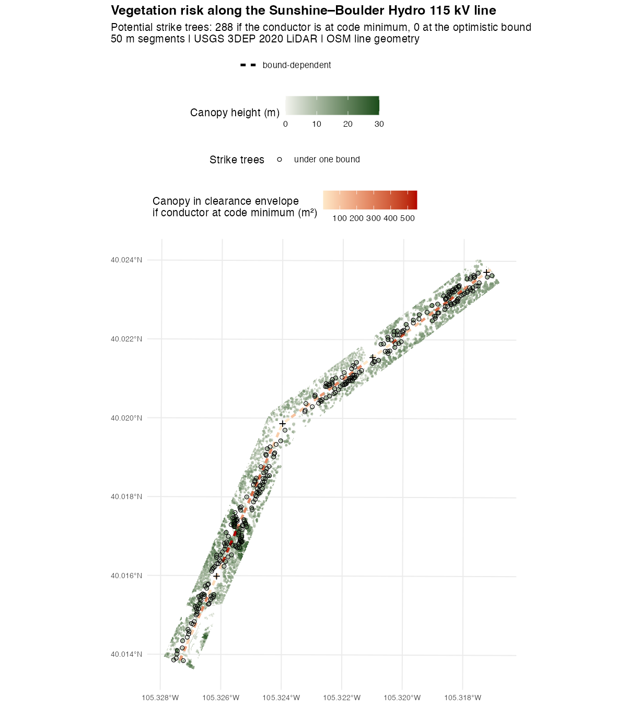
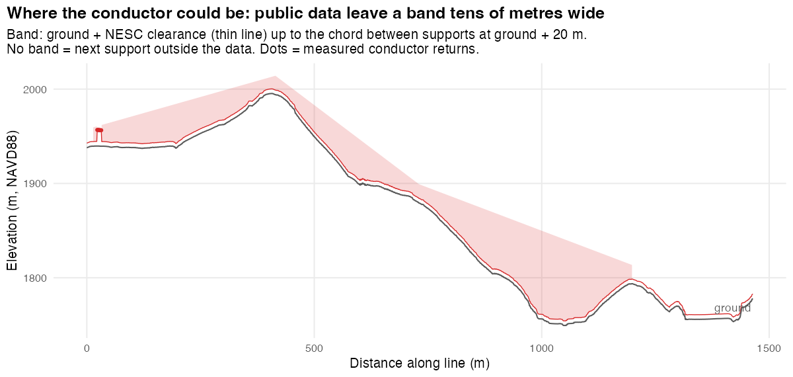
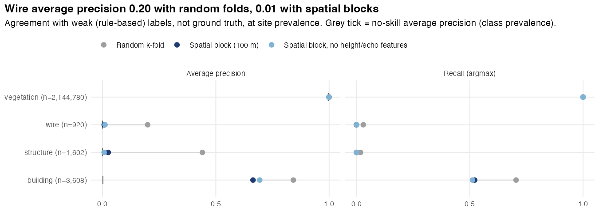
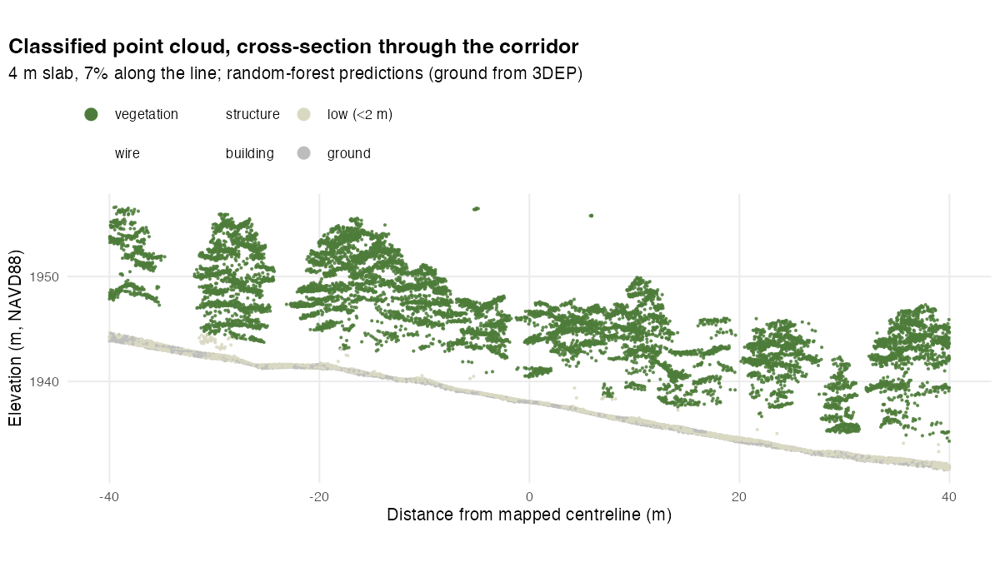

# powerline-veg-risk

**Screening a transmission corridor for vegetation risk from public airborne LiDAR, in R.**

`vegrisk` is a small R package plus a reproducible case study. It takes USGS 3DEP point clouds (LAS/LAZ) and OpenStreetMap power-line geometry and produces a segment-by-segment screen for the two vegetation failure modes utilities manage:

- **Grow-in:** canopy growing up into the clearance envelope beneath the conductors.
- **Fall-in:** "strike trees" beside the line that are tall enough to reach a conductor if they fall.

The case study is the **Sunshine–Boulder Hydro 115 kV line** in Sunshine Canyon, Boulder County, Colorado. It's wildland–urban interface: the 2010 Fourmile Canyon Fire burned about 2.5 km to the north-west. Inputs are 1.46 km of line, about 2.2 M above-ground LiDAR points (USGS `CO_DRCOG_2020`, ~35 pts/m²), 5 tagged OSM structures, and 33 OSM buildings.



## Pipeline

```
3DEP tiles (TNM API) ─┐
                      ├─ clip to 45 m corridor ─ height-normalise (TIN on class 2)
OSM line (Overpass) ──┘                │
                                       ▼
          per-point features: multi-scale eigenvalue shape (k = 10, 30),
          echo structure, intensity percentile, height
                                       │
          weak labels from GIS + geometry (no labelled classes in 3DEP)
                                       │
          random forest (ranger), class-weighted, prior-corrected;
          spatially blocked CV vs random CV; feature ablation
                                       │
          vegetation-only canopy height model ─ treetops (local maxima)
                                       │
          conductor elevation: measured where seen, bounded elsewhere
                                       │
          per 50 m segment: clearance encroachment + strike trees
          under both conductor bounds, with a confidence label
```

| Step | Function | File |
|---|---|---|
| Find / download 3DEP tiles, fetch OSM layers | `tnm_lidar_tiles()`, `download_tiles()`, `osm_power_lines()`, `osm_power_structures()`, `osm_buildings()` | [R/fetch.R](R/fetch.R) |
| Corridor clip, noise removal, height normalisation, CRS-unit safety | `read_corridor()`, `line_corridor()`, `las_m_per_unit()` | [R/preprocess.R](R/preprocess.R) |
| Point features | `point_features()` | [R/features.R](R/features.R) |
| Weak labels | `weak_labels()` | [R/labels.R](R/labels.R) |
| Classifier and validation | `train_point_classifier()`, `cv_point_classifier()`, `classify_probs()`, `predict_points()` | [R/classify.R](R/classify.R) |
| Conductor model and risk | `conductor_profile()`, `corridor_rasters()`, `assess_risk()` | [R/risk.R](R/risk.R) |
| Figures | `plot_risk_map()`, `plot_profile()`, `plot_cross_section()`, `plot_cv()`, `plot_importance()` | [R/plot.R](R/plot.R) |

## Design decisions worth reading

**Distances are always metres.** Point clouds stay in their native CRS, and every parameter is converted with `las_m_per_unit()`. Without that, a US-survey-feet state-plane tile would silently shrink every buffer by 3.28×. Geographic CRSs are rejected.

**Labels are weak, and the code says so.** This 3DEP delivery is classified only to ground, unclassified, noise and bridge, the norm for 3DEP. There are no vegetation, wire or building labels to learn from. Training labels come from:

- **building:** OSM footprints, shrunk 1 m inward so crowns overhanging eaves don't count as roof.
- **structure:** OSM pole and tower nodes.
- **wire:** an air-gap test (an elevated, thin layer with empty space beneath it across a 3×3 m window) plus an **along-line run test** in chainage/offset coordinates. Each conductor row must extend ≥ 12 m along the line. Parallel phases pass; crown tops are compact and don't.
- **vegetation:** everything else.

Elevated near-line candidates that fail the wire test **abstain** (NA) rather than becoming "vegetation", so missed conductors aren't taught as trees.

**Validation is spatial, and the gap is reported.** Neighbouring LiDAR points share neighbourhoods, so random k-fold CV leaks information between folds. Folds are 100 m spatial blocks, and both schemes are reported. Precision is measured at the site's real class prevalence (wire is 0.04% of points). The headline metric is average precision against its no-skill baseline, plus an ablation that drops the features which encode the labelling rule (height, echo structure).

**Class weighting is undone at prediction time.** The forest trains with inverse-frequency case weights, which estimates posteriors under equal priors. `classify_probs()` multiplies by the true prevalence and renormalises. Without that correction the model flagged about 25,000 vegetation points as "wire" (precision 0.02).

**Conductor elevation is bounded, not guessed.** A "constant height above the ground below" conductor model is wrong wherever a span crosses a gully, and this line drops 250 m into a canyon. `conductor_profile()` brackets the conductor:

- **lower bound:** ground + 4.9 m, roughly the NESC clearance for 115 kV over land accessible only to pedestrians.
- **upper bound:** the straight chord between the supports either side of a station, each at ground + 20 m. A conductor sags below the chord between its attachments. Where the next support lies outside the data, the upper bound is reported as unknown rather than invented.

Conductor returns override the bounds only if they pass sanity checks:

- They are farther than 8 m from a structure. Guy wires, crossarms and insulators there are elevated and linear too, and an earlier version mistook them for conductors.
- The 25th percentile per 5 m bin lies above the code-minimum lower bound.
- The implied slope to a neighbouring bin is ≤ 0.2.

Every risk metric is computed under both bounds, and each segment is labelled `measured`, `robust` (same answer under both bounds) or `bound-dependent`.

**Fall-in uses 3D geometry and terrain.** A tree pivoting at its base sweeps a sphere of radius *h*. It can strike if the 3D distance from its base to the nearest conductor point (DTM at the tree, modelled conductor elevation, outer phases 5.5 m from the centreline) is ≤ *h*. Trees inside the under-line zone count as grow-in, not strike, so nothing is double-counted.

**Only consensus vegetation enters the canopy model.** At the real class mix, the prior-corrected classifier rarely predicts wire. Building the canopy height model from its argmax alone would let conductor returns over trees set the canopy height to the conductor's height, giving zero clearance by construction. So the canopy height model uses only points that both the model and the rules call vegetation.

**Structures are masked.** H-frames and crossarms otherwise appear as 18 m "trees" right under the conductors. Cells within 8 m of OSM structure nodes and the line's vertices are treated as unobserved. OSM mappers put a node at each structure, and here they match the H-frames visible in the point cloud. Features one or two cells wide are removed with a 3×3 crown-support filter.



## Results

**Classifier.** These are spatially blocked CV results, scored against weak labels at site prevalence:

| class | n | prevalence | avg. precision (spatial) | avg. precision (random folds) | avg. precision (spatial, no height/echo) |
|---|---:|---:|---:|---:|---:|
| vegetation | 2,144,780 | 0.997 | 0.999 | 0.999 | 0.999 |
| building | 3,608 | 0.0017 | 0.67 | 0.85 | 0.71 |
| structure | 1,602 | 0.0007 | 0.025 | 0.44 | 0.007 |
| wire | 920 | 0.0004 | 0.008 | 0.20 | 0.011 |



- **Buildings transfer across space.** Average precision is 0.67, against a no-skill value of 0.0017.
- **Wires and structures don't.** Random-fold CV makes them look learnable (average precision 0.20 and 0.44), but under spatial blocking they drop to 0.008 and 0.025: some lift over prevalence, nothing usable. Wire and structure labels occur in only 3 of the 5 spatial folds, which is effectively a handful of spans and five structures.
- **Random CV on point clouds would have produced a misleading model card.** That is the main methodological result here.

**Corridor.** The honest answer is that public data can't decide grow-in on this line:

| | optimistic conductor (upper bound) | pessimistic conductor (code minimum) |
|---|---|---|
| segments with ≥ 5 m² of canopy in the clearance envelope | **0 of 29** | **28 of 29** |
| potential strike trees | 0 | 288 |

- **Conductor returns are scarce.** After the sanity checks, they survive along only 1% of the line; the 2020 acquisition rarely sampled the conductors mid-span.
- **Spans are long.** The supports are 257–468 m apart, so the conductor could be anywhere in a band tens of metres tall (see the profile above).
- **Every segment is `bound-dependent`.** The ranking by pessimistic encroachment (`segments.csv`) is a "where to look first" list, not a finding. The top two segments (1.06–1.16 km along the line) are tall riparian stands on the canyon floor, beneath the longest span.
- **An earlier version said otherwise.** It reported 3 "robust" grow-in segments. Review traced them to guy-wire returns read as conductor and to a span-length assumption the line violates. Both are fixed and covered by tests.

**What would turn this into a decision:** structure attachment heights, or the utility's sag-and-tension model (e.g. PLS-CADD), would collapse the band to a single line. So would a LiDAR flight planned to capture conductors. Everything downstream (clearances, 3D strike geometry, segment ranking) already takes a conductor profile as input.



## Limitations

- **Weak labels.** Every accuracy number above measures agreement with the labelling rules, not ground truth. The next step is a few hundred hand-labelled points in held-out blocks (e.g. in CloudCompare) for a true test set.
- **Sparse conductor sampling.** This 2020 acquisition rarely returned the conductors mid-span, so the conductor is bounded, not measured (see above).
- **Bounds rest on assumptions.** Attachments are taken as ≤ 20 m above ground, and every support is assumed to be an OSM vertex. A taller structure, or an unmapped intermediate structure, would invalidate the upper bound locally.
- **OSM geometry.** The centreline is digitised by volunteers. Detected conductor returns sit a median 4.9 m from it, consistent with ±5 m phase spacing plus 1–2 m of digitising error. Structures that aren't OSM vertices are not masked.
- **The structure mask** hides canopy within 8 m of each support, so strike trees right beside structures are not scored.
- **Treetops from a CHM** (local maxima, 5 m window) merge or split crowns in dense stands. Individual-tree segmentation would sharpen the strike-tree counts.
- **Vertical units** are assumed to match horizontal units. That holds for this UTM/NAVD88-metre delivery, but some state-plane products mix feet and metres.
- **A single line and a single acquisition.** Spatial CV tests transfer to other spans of the same line, not to other lines, regions or sensors.

## Reproduce

```r
# R >= 4.3
install.packages(c("lidR", "sf", "terra", "lwgeom", "ranger", "FNN", "data.table",
                   "httr2", "units", "withr", "ggplot2", "scales", "devtools"))
```

```bash
Rscript analysis/run_sunshine_canyon.R   # downloads ~0.6 GB of 3DEP LiDAR on first run; ~4 min after that
Rscript -e 'devtools::test()'           # unit tests: synthetic geometry + lidR example data, no network
```

The OSM layers used in the case study are cached in `data-raw/*.geojson`, so reruns are reproducible even if OSM changes. Outputs go to `output/`: `segments.gpkg`, `trees.gpkg`, `segments.csv`, `conductor_profile.csv` and `cv_metrics.csv`.

## Data

- **LiDAR:** U.S. Geological Survey 3D Elevation Program, `CO_DRCOG_2020_B20` tiles `w0472n4429` and `w0472n4430`, public domain.
- **Power lines, structures, buildings:** © OpenStreetMap contributors, ODbL.
