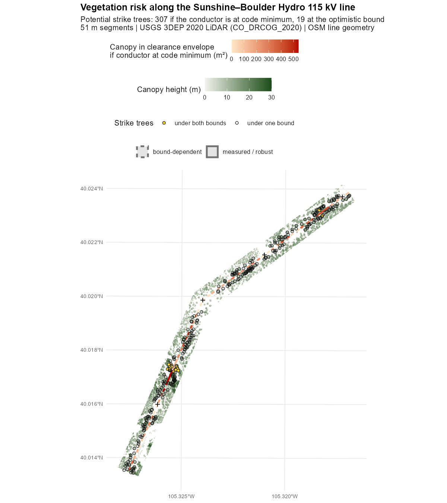
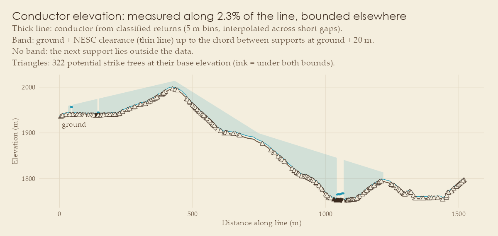
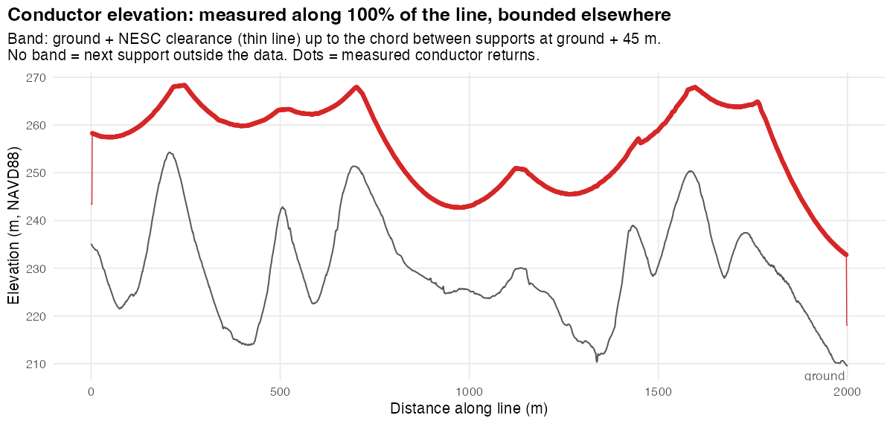

# vegrisk

<!-- badges: start -->
[](https://github.com/mjorden/powerline-veg-risk/actions/workflows/R-CMD-check.yaml)
[](LICENSE.md)
[](https://mjorden.github.io/powerline-veg-risk/)
<!-- badges: end -->

**Which trees threaten a power line? A screen from public airborne LiDAR, in R.**

`vegrisk` turns USGS 3DEP point clouds and OpenStreetMap line geometry into a segment-by-segment screen for the two vegetation failure modes utilities manage: canopy growing into the clearance envelope (**grow-in**) and trees tall enough to reach a conductor if they fall (**fall-in**). Public LiDAR has no wire labels, so the package learns them from geometry; the conductor elevation is measured where the LiDAR saw the wires and bracketed where it did not, so every finding carries its confidence. Optional steps rank the grown-in canopy by dry-season greenness (Landsat) and the strike trees by which fire-weather winds would throw them into the line (ERA5, NWS).



## What two corridors showed

1. **Whether public LiDAR can decide grow-in depends on whether it sampled the conductors.** In Colorado it barely did (2% of the line), so 27 of 30 segments stay undecidable and 3 are robust candidates. In Nashville the 500 kV bundles were sampled end to end, and the same pipeline gives a measured, decisive screen.
2. **Vendor vegetation classes contain the conductors.** In Nashville, 99.3% of conductor returns are delivered as *high vegetation*. A canopy model built from the delivered classes flags every one of 39 segments as grow-in; with conductor returns removed, none are.
3. **Random cross-validation on point clouds misleads.** Random folds report a Colorado wire average precision of 0.21; 100 m spatial blocks report 0.003. The Colorado model does not transfer to Nashville.
4. **Wind direction splits the strike trees in two.** Nine in ten Colorado fire-weather hours blow from the west, so the 307 potential strike trees divide into 126 windward of the line and 181 leeward, and the top grow-in candidate also holds the most windward trees.

## Two corridors

<table>
<tr>
<td width="50%"></td>
<td width="50%"></td>
</tr>
<tr>
<td valign="top"><b>Sunshine Canyon, Colorado.</b> 115 kV on wood H-frames in the wildland–urban interface, 2.5 km from the 2010 Fourmile Canyon Fire. Conductor bounded, not measured: 3 robust grow-in candidates, 27 undecidable segments, 19–307 strike trees depending on the bound. <a href="https://mjorden.github.io/powerline-veg-risk/articles/sunshine-canyon.html">Case study →</a></td>
<td valign="top"><b>West Nashville, Tennessee.</b> TVA 500 kV on lattice towers, LiDAR in US survey feet with vendor classes to check against. Conductor measured along the whole line: no grow-in, 24 strike trees in 7 segments, 32 segments seen to be clear. <a href="https://mjorden.github.io/powerline-veg-risk/articles/nashville.html">Case study →</a></td>
</tr>
</table>

## How it works

3DEP tiles and OSM lines → corridor clip and height normalisation → per-point shape, echo and height features → weak labels from GIS and geometry → class-weighted random forest with spatially blocked cross-validation → conductor elevation measured where seen, bounded elsewhere → canopy model with conductor returns removed → per 50 m segment, clearance encroachment and 3D strike trees under both bounds, with a confidence label. Every distance is metres whatever the CRS; unseen ground is never read as clear.

- [How the screen works](https://mjorden.github.io/powerline-veg-risk/articles/methods.html): pipeline, design decisions, data sources, how to reproduce.
- [Limits and roadmap](https://mjorden.github.io/powerline-veg-risk/articles/limits-and-roadmap.html): what it does not do, and what a next version would change.
- [Function reference](https://mjorden.github.io/powerline-veg-risk/reference/index.html).

## Reproduce

```bash
Rscript analysis/run_sunshine_canyon.R   # ~0.6 GB of 3DEP LiDAR on first run
Rscript analysis/run_nashville.R         # ~0.3 GB; scores the Colorado model here too
Rscript -e 'devtools::test()'           # synthetic geometry + lidR example data, no network
```

Data: USGS 3DEP (public domain), © OpenStreetMap contributors (ODbL), USGS Landsat Collection 2 via the Microsoft Planetary Computer, Copernicus ERA5 via Open-Meteo (CC BY 4.0), U.S. National Weather Service API.
