# Style spike: mid-century earth tones, Tufte rules

Status: **design spike, no default change.** The new style is opt-in:

```r
options(vegrisk.style = "midmod")   # default stays "classic"
```

With the option unset, every figure is byte-identical to `main`. This was
checked by rendering on both branches and comparing MD5 hashes (see
[Verification](#verification)).

## What is in the spike

| Piece | Where |
|---|---|
| Palette, both styles, keyed by role | `vegrisk_palette()` in `R/plot.R` |
| Theme | `theme_vegrisk(base_size, style)` |
| Internal scale helpers | `scale_fill_vegrisk_canopy()`, `scale_colour_vegrisk_encroach()`, `_wind()`, `_class()`, `_scheme()`, `_dryness()` |
| Font fallback | `vegrisk_font()` (uses `systemfonts` if installed, otherwise a generic family) |
| Prototypes | `risk_map_midmod()` and `cv_midmod()`, reached through `plot_risk_map()` / `plot_cv()` when the option is set |
| Figures | `analysis/style_spike_figures.R` → `analysis/figures/style-spike/` |
| Tests | `tests/testthat/test-plot-style.R` |

No plot function names a hex value any more. The classic hex values moved
unchanged into `vegrisk_palette("classic")`, and a test greps every `plot_*`
and `*_midmod` body for `#rrggbb`.

## Palette

Paper `#F4EEDE` (parchment), ink `#3B2A1E` (dark umber). The table gives
OKLCH lightness L, chroma C, and WCAG contrast against the paper.

### Ink and neutrals

| Role | Hex | L | C | Contrast | Use |
|---|---|---|---|---|---|
| paper | `#F4EEDE` | – | – | – | plot and file background |
| ink | `#3B2A1E` | 0.30 | 0.033 | 11.8 | titles, strike-tree marks, scale bar |
| ink2 | `#6B5744` | 0.47 | 0.039 | 5.9 | body text, axis text, legends (WCAG AA for small text) |
| muted | `#8C7B68` | 0.59 | 0.035 | 3.5 | non-text reference marks only (no-skill tick) |
| rule | `#E3D9C4` | 0.89 | 0.030 | 1.2 | hairline grid, connector lines |
| no data | `#8E8578` | 0.62 | 0.022 | 3.1 | unscored segments (`na.value`; PR #23's grey dotted "no data" segments) and `rasters$unobserved` cells (#33 item 1). Unobserved means no data, so they share a colour |

### Categorical: point classes

| Class | Hex | Name | L | C | Contrast |
|---|---|---|---|---|---|
| vegetation | `#606A04` | olive | 0.50 | 0.112 | 5.1 |
| **wire** | `#1F95B2` | muted teal | 0.62 | 0.106 | 3.0 |
| structure | `#6E3318` | burnt umber | 0.39 | 0.093 | 8.4 |
| building | `#AE7F1E` | ochre / mustard | 0.63 | 0.120 | 3.1 |
| low (<2 m) | `#E1CFB3` | tan | 0.86 | 0.043 | 1.3 |
| ground | `#AFA497` | stone | 0.72 | 0.022 | 2.1 |

Wire is the one cool hue in a warm palette, so the rare class reads first.
Burnt orange is kept for the risk ramp, so "orange" always means risk.

### Sequential ramps

| Ramp | Anchors (light → dark) | Light end vs paper |
|---|---|---|
| encroachment, wind hit | `#CB8E33` ochre → `#B5562A` burnt orange → `#6B2A12` deep rust | 2.45:1 |
| canopy height | `#AEAB75` sage → `#7F8747` olive → `#38431A` deep olive | 2.05:1 |
| canopy height, faint (backdrop under wind points) | `#D9D4B4` → `#AEAB75` | – |

Both ramps are interpolated in CIELAB. Neither starts at a near-white, so the
lowest value is still visibly different from "nothing here". This is the
root cause of #5 and #10 item 3.

### CV schemes (plot_cv)

| Scheme | Hex | Mark |
|---|---|---|
| random k-fold | `#6B5744` ink2 | hollow circle (the optimistic reference) |
| spatial block | `#1F95B2` teal | filled (the headline) |
| spatial block, ablation | `#AE7F1E` ochre | filled |

## CVD and contrast results

Measured with the `dataviz` skill's `validate_palette.js`: Machado 2009 CVD
simulation at severity 1.0, ΔE = OKLab distance × 100, target ≥ 8 and floor
≥ 6 with secondary encoding, normal-vision floor ≥ 15. Point classes
are scored **all-pairs**, because in a scatter any two classes can be
neighbours.

**Point classes, ΔE for every pair**

| Pair | normal | protan | deutan | tritan |
|---|---|---|---|---|
| **vegetation–wire** | **21.1** | **22.2** | **20.4** | **17.6** |
| vegetation–structure | 16.0 | 15.4 | 10.5 | 15.0 |
| vegetation–building | 14.8 | 9.9 | 13.5 | 16.0 |
| vegetation–low | 37.3 | 35.7 | 36.6 | 36.5 |
| vegetation–ground | 24.6 | 23.3 | 23.5 | 22.6 |
| wire–structure | 30.1 | 32.3 | 25.5 | 32.4 |
| wire–building | 21.2 | 18.6 | 19.6 | 20.5 |
| wire–low | 27.9 | 21.7 | 27.8 | 27.1 |
| wire–ground | 16.2 | 9.6 | 14.9 | 15.9 |
| structure–building | 24.3 | 25.3 | 23.9 | 23.4 |
| structure–low | 47.1 | 49.9 | 46.4 | 47.2 |
| structure–ground | 33.7 | 36.6 | 32.7 | 34.0 |
| building–low | 24.7 | 26.7 | 24.2 | 24.0 |
| building–ground | 13.8 | 15.8 | 13.3 | 12.0 |
| low–ground | 13.9 | 13.5 | 14.1 | 13.9 |

For comparison, the current classic colours for wire `#d62728` and
vegetation `#4d7c3a` have nearly the same luminance (≈0.16), and the pair
collapses under deuteranopia (#10 item 2).

The validator's verdict, verbatim:

```
[FAIL] Lightness band   outside band: #6E3318 0.395, #E1CFB3 0.862
[FAIL] Chroma floor     below floor: #6E3318 0.093, #E1CFB3 0.043, #AFA497 0.022
[PASS] CVD separation   worst all-pairs #AFA497↔#1F95B2 ΔE 9.6 (protan) · tritan 12.0
[FAIL] Normal-vision    worst all-pairs #AFA497↔#AE7F1E ΔE 13.8 — below 15
[WARN] Contrast         #E1CFB3 1.32, #AFA497 2.11
```

How to read it:

- **CVD passes everywhere, all pairs, worst case 9.6.** This was the goal.
  The critical wire–vegetation pair is at least 17.6 under every deficiency.
- The lightness-band and chroma "fails" are deliberate. Ground and low are
  **context**, not identities to compare: they are meant to be pale and
  near-neutral so they recede. Structure is meant to be dark.
- **Normal-vision floor: three pairs at 13.8–14.8** (vegetation–building,
  building–ground, low–ground). In a random search of 150 000 earth-tone
  palettes under the same contrast constraints, no six-colour set beat this
  worst case: six classes in all-pairs exceed what the method allows (it
  caps all-pairs forms at about three hues). The relief channels in the
  cross-section are spatial position (buildings and ground do not mix in a
  2 m slab) and draw order (rare classes on top). When `plot_cross_section()`
  is converted, building should also get a different point shape.
- The low-contrast low/ground classes need direct labels or a table view under
  the validator's rules. The cross-section legend gives keys, not labels, so
  this stays open for the conversion (see estimate).

**Ramps** (`--ordinal`, five sampled steps): both PASS monotone lightness,
adjacent ΔL ≥ 0.06, light end ≥ 2:1 and single hue (encroachment spread 33°,
canopy 16°).

**Segments over canopy:** deep rust over deep olive is 1.25:1, and only ΔE
3.4 under deuteranopia. So **the paper casing under every segment is
required**, not decoration. It is drawn in the prototype.

**CV schemes:** all pairs pass. Worst is 16.5 (protan, random–ablation),
normal-vision 17.6, and every mark is ≥ 3:1 on paper. The chroma "fail" on
random is deliberate: it is the grey reference.

**Text:** ink 11.8:1 and ink2 5.9:1, both WCAG AA for normal text. Muted
(3.5:1) is used only for a non-text mark.

The full validator output is in `analysis/figures/style-spike/validation.txt`.

## Type

- **Titles and facet strips**: a geometric sans. The first installed of
  Futura, Avenir Next, Century Gothic, Gill Sans, else the device `sans`.
- **Everything read closely** (subtitles, axes, legends): a serif. The first
  of Charter, Palatino, Palatino Linotype, Book Antiqua, Georgia, else
  `serif`.
- The lookup uses `systemfonts`, which is already installed wherever `ragg`
  is and was added to **Suggests** only. Without it, the theme asks for the
  generic families and never errors. There are no new hard dependencies.
- macOS has Futura and Charter. Debian/Ubuntu CI typically has none of these,
  so it falls back to DejaVu Sans / DejaVu Serif. That is acceptable, but
  the look depends on the fonts. If the README figures are rendered on CI,
  either install `fonts-urw-base35` (URW Gothic ≈ Avant Garde and P052 ≈
  Palatino, both free) and add them to the preference lists, or keep
  rendering the README figures locally.

## Tufte choices in the theme

- Ink on paper. Hairline major grid only, no ticks, boxes or panel borders.
  The grid is removed entirely on maps and on the categorical axis of
  `plot_cv`.
- Maps drop the graticule (decimal degrees on one map, raw UTM on another,
  #33 item 2) and use a metric **scale bar** sized with `crs_m_per_unit()`.
- Line type is explained in one subtitle sentence, only when dashed segments
  are present, instead of in a legend box.
- Colour bars are short and horizontal, with the title on top, so all keys
  fit in one row above the map.
- Hollow and filled marks give a second channel next to colour, for strike
  trees (both bounds / one bound) and for CV schemes (reference / spatial).

## Prototypes

### `plot_risk_map()`

Fixes folded in, active in the midmod style only:

- **#5**: zero encroachment is drawn as **absence**: a thin umber line
  with no colour. The ochre→rust ramp covers only values above zero, with
  the scale anchored at 0. When no segment has encroachment (Nashville), the
  colour bar is dropped and the subtitle says "No canopy in the clearance
  envelope on any segment".
- **#33 item 1**: `rasters$unobserved` cells (conductor returns removed,
  no canopy) are drawn as 1 m tiles in the "no data" neutral, **over** the
  paper casing, because they hug the line. The subtitle reports their area
  (Nashville: 267 m²; Sunshine: 3 m²). At full-corridor scale they are
  barely visible, so the number carries the message. Structure-masked
  cells, which `assess_risk()` treats as unobserved, are not in
  `rasters$unobserved`, so they are not shown; that needs `assess_risk()` to
  return its mask.
- **#33 item 3**: segments are drawn last, over a paper casing, so strike
  markers no longer hide the encroachment colour. Trade-off: the casing
  (≈ ±6 m at the Sunshine scale) now nibbles the rims of the strike markers
  nearest the line. They stay readable because of their paper/ink rims.
- **#33 item 7**: the top canopy break is "30+".
- **#10 item 3**: zero segments no longer vanish into a near-white backdrop.
- **#10 item 1** (for this map): the strike-tree legend always shows both
  keys, through `drop = FALSE` plus `override.aes`, even when one kind is
  absent.
- Strike trees are drawn as an ink dot with a paper rim (both bounds) and a
  paper dot with an ink rim (one bound). Both stay legible on pale and on
  dark canopy.
- `na.value` is set to the "no data" neutral, ready for PR #23.
- The scale bar is sized from the horizontal extent of the panel.

| | Classic (current default) | Midmod |
|---|---|---|
| Sunshine | 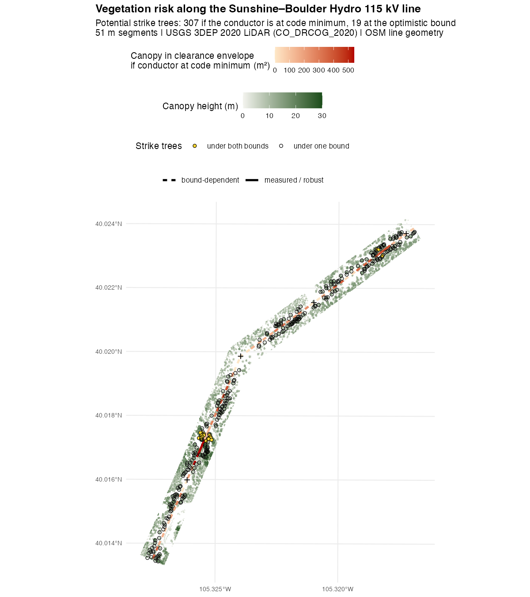 | 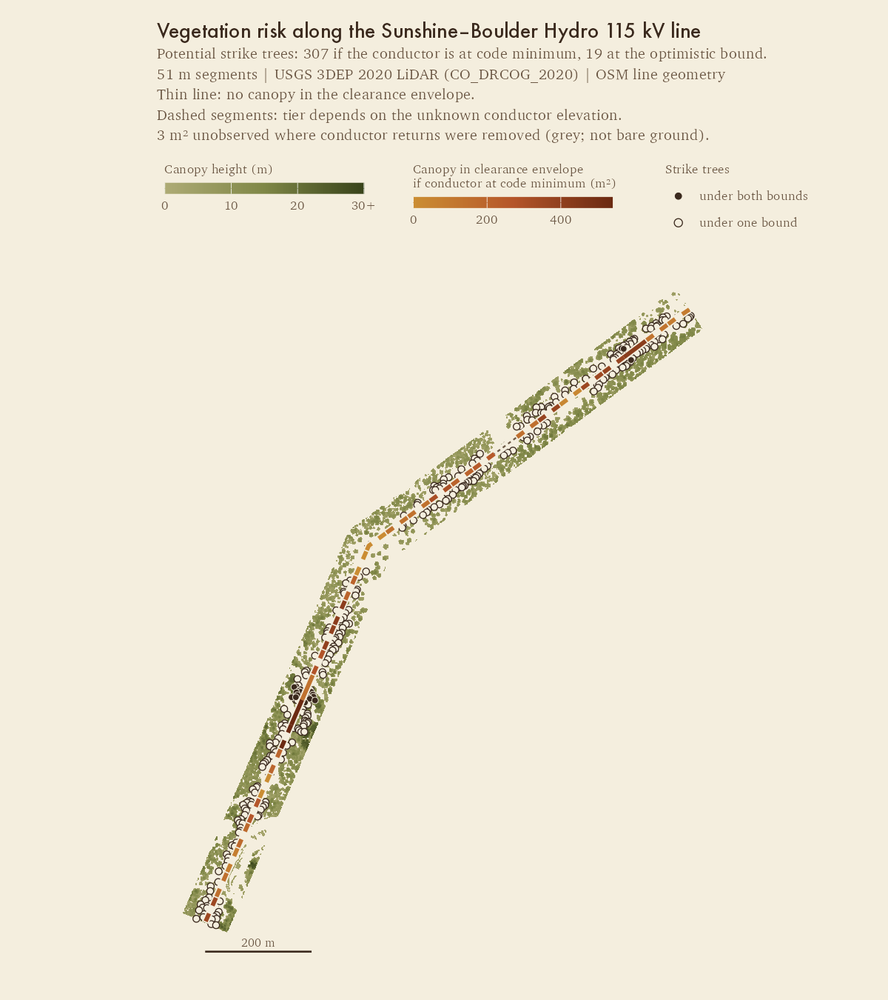 |
| Nashville (no grow-in: #5) | 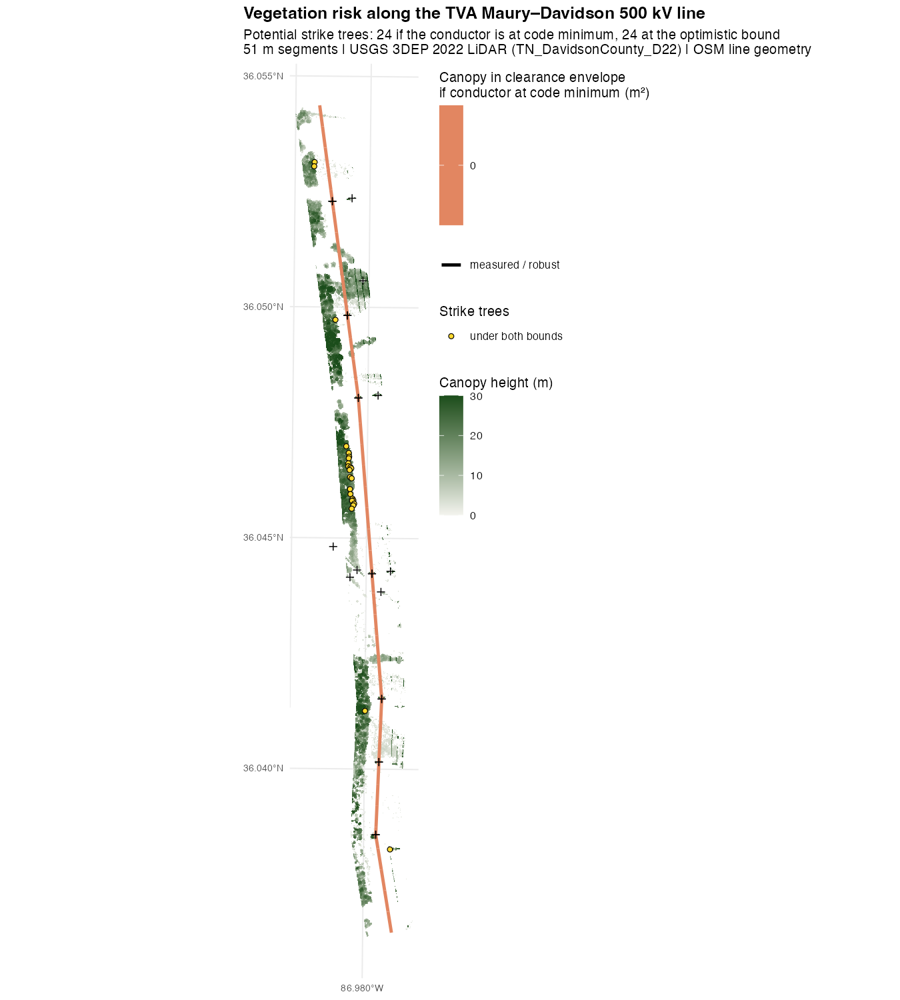 | 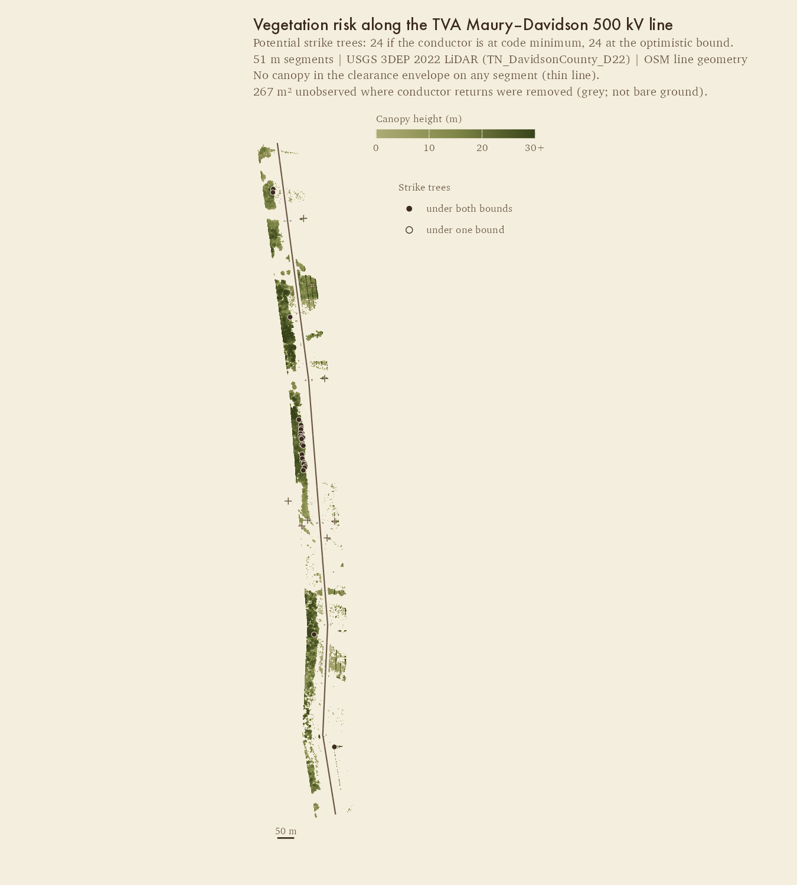 |
| Synthetic (test-risk.R fixtures, with an unobserved patch) | 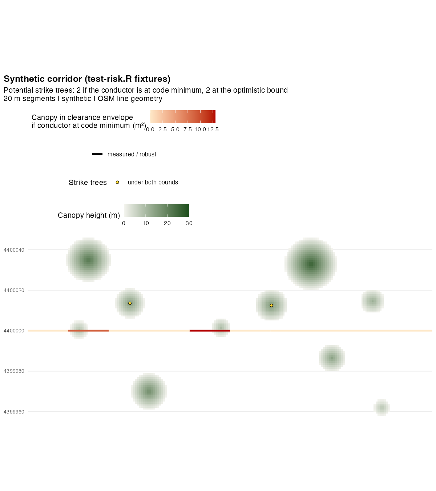 | 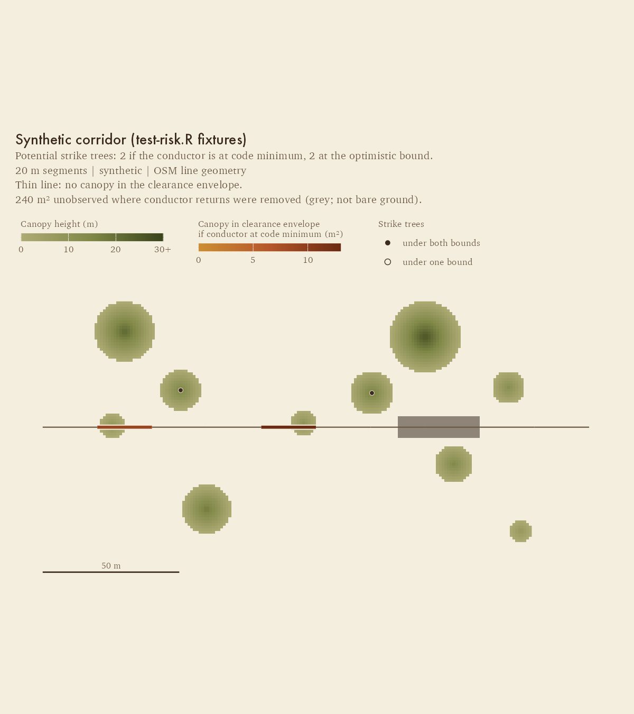 |
| Synthetic, all segments zero (#5; strike trees but no grow-in) | 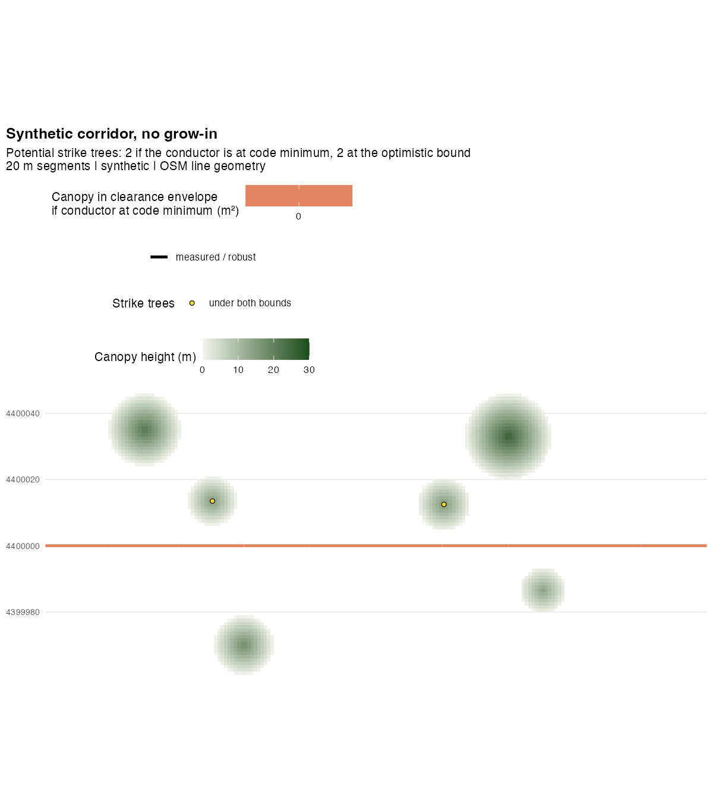 | 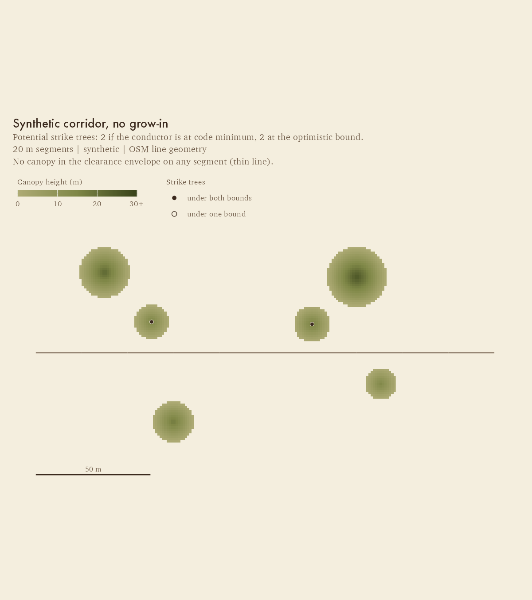 |

### `plot_cv()`

Fixes folded in from **#34**, midmod style only:

- Schemes are offset vertically within each class row, so the spatial-block
  point is never hidden.
- AP in the title has two significant figures below 0.01: "0.004", not "0.00".
  The title falls back to a generic one when there is no wire row (the
  prototype crashed on this before review).
- Colours and shapes are keyed **by scheme name**, so a subset of schemes
  keeps its colours.
- Unknown schemes are kept under their raw name in a neutral colour, with a
  warning, instead of silently dropped.
- `n` is taken from any scheme, so there is no "n=NA" without
  `spatial_block`. Classes absent from `metrics` get no row.
- The connector is a horizontal range rule at the row centre (min to max
  across schemes), not a slanted line through the offset points.

| | Classic | Midmod |
|---|---|---|
| Sunshine | 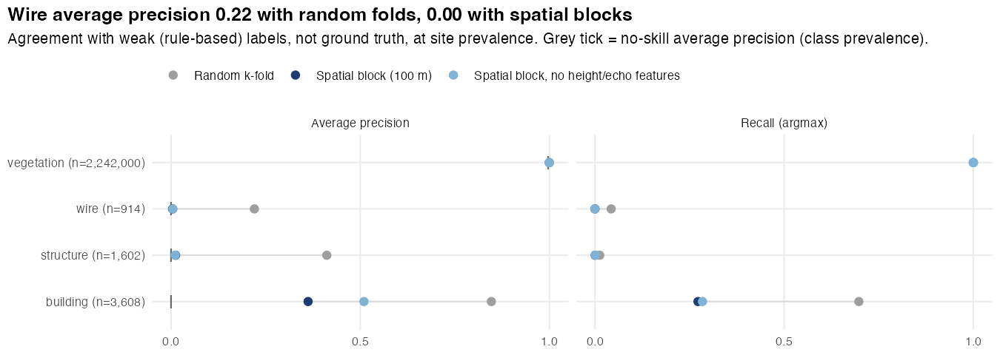 | 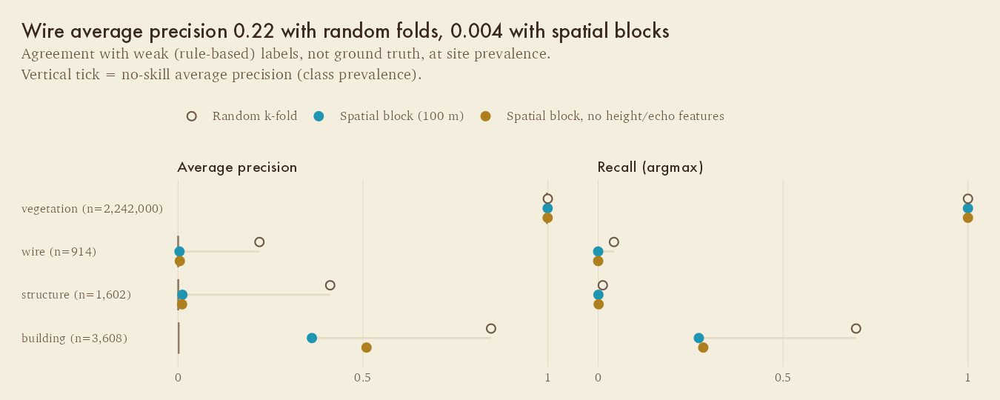 |
| Nashville | 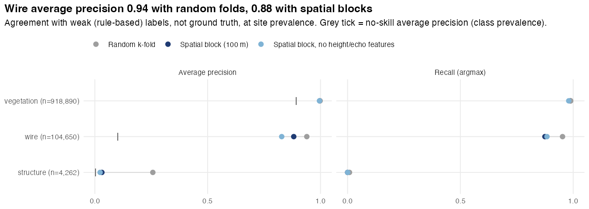 | 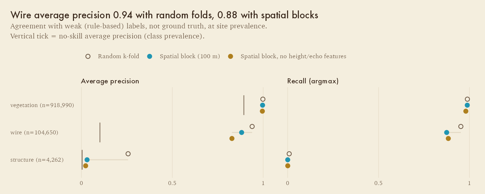 |
| Synthetic | 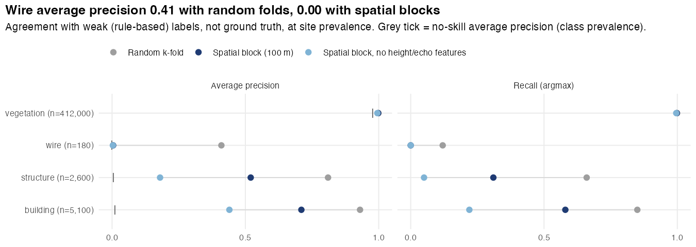 | 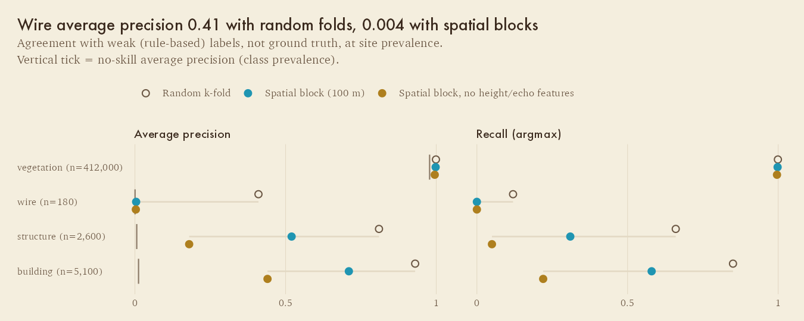 |

## Estimate: converting the rest and closing the graphics issues

The palette, theme, helpers, casing and scale-bar code already exist, so most
of the remaining work is the issue fixes, not the restyle. The estimates are
for one person, including tests and regenerated README figures.

| Work | Covers | Estimate |
|---|---|---|
| `plot_importance()` | restyle only | 0.5 h |
| `plot_cross_section()` | #10 items 1–2 (keys for absent classes via `show.legend = TRUE`, new class palette), building as a different shape, direct labels for wire/structure | 2–3 h |
| `plot_profile()` | #12 (draw strike trees at their base, `line_id` argument and message), #32 (return the 5 m bins as an attribute of `conductor_profile()` and plot them as dots, break the floor line at `src` changes, conditional title), plus restyle | 1 day (touches `R/risk.R`) |
| `plot_canopy_dryness()` | #11 item 1 (sequential ramp; mark the `dry_quantile` cut), #10 items 1 and 3, #33 items 5 (`bound` argument) and 8 (ISO dates), plus restyle | 0.5–1 day |
| `plot_wind_exposure()` | #11 item 2 (`scale_y_sqrt()` rose, ring labels), #11 item 3 (break at `windward_min`, threshold in title), #33 item 6 (outlined points, "over canopy height"), plus restyle | 0.5 day |
| Shared map helpers | #33 item 2 (scale bar and `map_axes` on all three maps; factor out of `risk_map_midmod()`), #33 item 4 (supports keyed in `aes()`, documented) | 2–3 h |
| Flip the default | fold `*_midmod()` into the exported functions, delete the classic palette and the option, regenerate `man/figures`, check pkgdown | 2–3 h |
| **Total** | closes #5, #10, #11, #12, #32, #33, #34 | **≈ 3–4 days** |

Suggested order: (1) flip `plot_risk_map` and `plot_cv` as prototyped, which
closes #5 and #34. (2) `plot_cross_section` and `plot_importance`, which
closes #10 together with the dryness map. (3) The maps, which close #11 and
#33. (4) `plot_profile`, which closes #12 and #32.

## Known limits of the spike

- `options(vegrisk.style = "midmod")` also restyles the five unconverted
  functions (palette, theme, parchment), but without their fixes. Dryness,
  for example, still uses BrBG, now on parchment. Treat those as untouched.
- No automated check guards classic byte-identity (no vdiffr snapshots).
  The verification below was done by hand. The hex test only catches
  `#rrggbb` literals: the dryness map's `palette = "BrBG"` is still a
  literal palette name.
- Two unknown CV schemes share the neutral colour and shape.
- Found while capturing Nashville, unrelated to this PR: in
  `analysis/pipeline.R`, `cfg$wind` partial-matches `cfg$window_m`, so a
  fresh Nashville run fails in the wind step ("$ operator is invalid for
  atomic vectors"). The capture script works around it with
  `cfg[["wind"]]`.

## Open questions for review

1. **Wire = teal.** The alternative is wire in burnt orange, the "danger"
   hue, with risk moved to a different ramp. It failed the all-pairs CVD
   check against olive (ΔE 4.3 protan), so teal it is, unless we give up the
   burnt-orange risk ramp.
2. **Paper background in PNGs.** The README sits on white (GitHub light) or
   near-black (dark mode). Parchment rectangles look intentional on white
   and like cards in dark mode. The alternative is `bg = NA` with paper only
   inside the panel.
3. **Fonts on CI** (see Type).
4. Whether a scale bar replacing coordinates is acceptable for every user. A
   `map_axes = "native"` escape hatch is planned under #33 item 2.

## Verification

- `devtools::test()`: all suites pass, including 16 new expectations in
  `test-plot-style.R`.
- Default output unchanged, checked three ways:
  1. Classic renders from this branch and from `main` (fixtures + saved
     case-study outputs) are byte-identical by MD5 for `plot_risk_map`,
     `plot_cv`, `plot_profile` and `plot_importance`.
  2. Re-running both case studies (`VEGRISK_REUSE=1`) on this branch
     reproduced every committed `man/figures` PNG byte for byte, except the
     Sunshine dryness and wind maps. Those differ from the committed files
     only in text rasterisation, with the same content, so the difference
     comes from the rendering environment, not the code.
  3. Re-running Sunshine on `main` in this environment produces dryness and
     wind PNGs whose MD5 matches this branch's.

  So all seven plot functions are unchanged by default.
- Real case-study inputs come from `VEGRISK_REUSE=1` pipeline runs with the
  LAZ tiles in `data-raw/laz/`. They are captured to
  `output/spike/<id>_riskmap_inputs.rds` (git-ignored). Without them,
  `style_spike_figures.R` renders the synthetic figures only.
