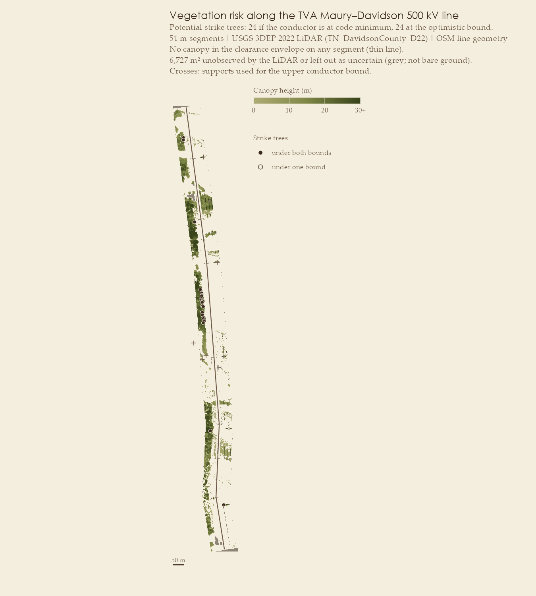

# Case study: West Nashville, Tennessee

|  |  |
|----|----|
| Line | TVA Maury–Davidson 500 kV, lattice towers, shared right-of-way (OSM way 19556523, 1.5–3.5 km from the Davidson end) |
| Setting | Wooded hills, managed right-of-way |
| LiDAR | `TN_DavidsonCounty_D22`, Tennessee State Plane **US survey feet**, ~34 pts/m², with vendor vegetation (3–5) and building (6) classes |
| Line length, above-ground points | 2.0 km, 1.05 M |
| Conductor returns found | 104,181, along ~100% of the line |
| Result | Decisive: no grow-in, 24 strike trees in 7 segments, 32 clear |



Nashville risk map

## The conductor is measured along the whole line


Nashville conductor profile

The 500 kV bundles were well sampled: 104,181 conductor returns, three
phases at about −12, 0 and +12 m, and a second circuit sharing the
right-of-way at +30–45 m. The profile shows clean catenaries between
towers, about 15–45 m above the ground (median 24 m).


Nashville cross-section

## Wires transfer across space here; the Colorado model does not

**Classifier against weak labels (spatial blocks):**

| class | n | prevalence | avg. precision, spatial blocks | random folds | spatial, no height/echo |
|----|---:|---:|---:|---:|---:|
| wire | 104,181 | 0.10 | **0.91** | 0.94 | 0.86 |
| structure | 4,262 | 0.004 | 0.008 | 0.26 | 0.006 |


Nashville cross-validation

Wires transfer across space here: average precision 0.91 against a
no-skill 0.10, and 0.86 even without the height and echo features, the
most direct proxies for the labelling rule. Structures (31 lattice
towers) still don’t.

**Against the vendor’s classes.** These are independent of the weak
labels. A geometric conductor zone (inside the measured conductor
envelope, within 3 m of the conductor or above) is excluded from scoring
for every method alike, because the vendor put conductors in vegetation.
Vegetation is 98.5% of the scored points, so its F1 can’t show skill:
predicting “vegetation” everywhere scores 0.992.

|  | vegetation F1 | building F1 | balanced accuracy | Cohen’s κ |
|----|---:|---:|---:|---:|
| always “vegetation” (baseline) | 0.992 | 0 | 0.50 | 0 |
| weak labels | 0.950 | 0 | 0.46 | 0.07 |
| model trained on weak labels | 0.957 | 0 | 0.47 | −0.01 |
| Colorado model, transferred | 0.992 | 0 | 0.50 | 0.00 |
| **trained on vendor labels (spatial CV)** | 0.998 | **0.87** (AP 0.95) | 0.89 | — |

- **On vegetation vs building, the weak-label pipeline has no skill at
  this site.** OSM maps one building in the corridor, so there are no
  building labels to learn from. The vendor’s labels would buy a
  building F1 of 0.87. The weak models’ lower vegetation recall is
  mostly second-circuit conductors and abstentions, which the vendor
  also calls vegetation.
- **The Colorado model doesn’t transfer.** With its own class prior it
  recalls 0% of Nashville’s conductor returns. Threshold-free, its wire
  average precision is 0.20 against a 0.10 baseline (the Nashville
  model: 0.86). Its 0.992 vegetation F1 is exactly the baseline.

## Vendor vegetation classes contain the conductors

99.3% of the conductor returns (103,449 points, 15–45 m up) are
delivered as *high vegetation*. The same segments, screened with three
different canopy models:

| canopy model | grow-in | fall-in | clear |
|----|---:|---:|---:|
| vendor vegetation classes, as delivered | 39 | 0 | 0 |
| vendor vegetation + this package’s conductor removal | 0 | 10 | 29 |
| **this package** (consensus vegetation + conductor removal) | **0** | **7** | **32** |

- **The delivered classes would send crews to every span.** Removing
  conductor returns is the whole grow-in correction (39 → 0). Consensus
  labelling (model and weak rules agreeing on vegetation, vendor
  buildings removed) then trims fall-in from 10 segments to 7.
- **No grow-in.** The managed right-of-way is clear under the
  conductors.
- **The 32 clear segments were seen, not assumed.** Every segment has at
  least 91% of its corridor and of its grow-in zone observed (median
  99%), so none is tiered `no data`. The lowest segment (0.36–0.41 km,
  91% under the line) is still 16 points above the 75% threshold.
- **24 strike trees across 7 segments,** 28–39 m from the centreline,
  the same under both bounds because the conductor is measured. They are
  the list to verify.
- **The conductor envelope has to cover every phase.** An earlier run
  capped it at 15 m while one outer phase sits up to ~19 m from the OSM
  centreline. That left outer-phase returns in the canopy model, which
  showed up as 2 grow-in segments and 4 extra strike trees at the
  envelope edge. Widening the grow-in zone to 21 m removed all of them.

## Configuration

``` r

run_case_study(list(
  id = "nashville",
  line_ids = "19556523", window_m = c(1500, 3500), start_north = TRUE,
  project = "TN_DavidsonCounty_D22",
  tiles = sprintf("USGS_LPC_TN_DavidsonCounty_D22_%s.laz",
                  c("155020", "155060", "155100", "155140", "169020")),
  half_width_m = 60, wire_search_m = 20, phase_offset_m = 11,
  under_line_m = 21, wire_zone_m = 25, structure_mask_m = 18,
  min_ground_clear_m = 8.5,            # NESC 232-1 order of magnitude for 500 kV
  attach_m = 45,                       # upper limit on lattice attachment height
  vendor_classes = TRUE,
  transfer_from = "sunshine"           # score the Colorado model here
))
```

The full script is `analysis/run_nashville.R`.
