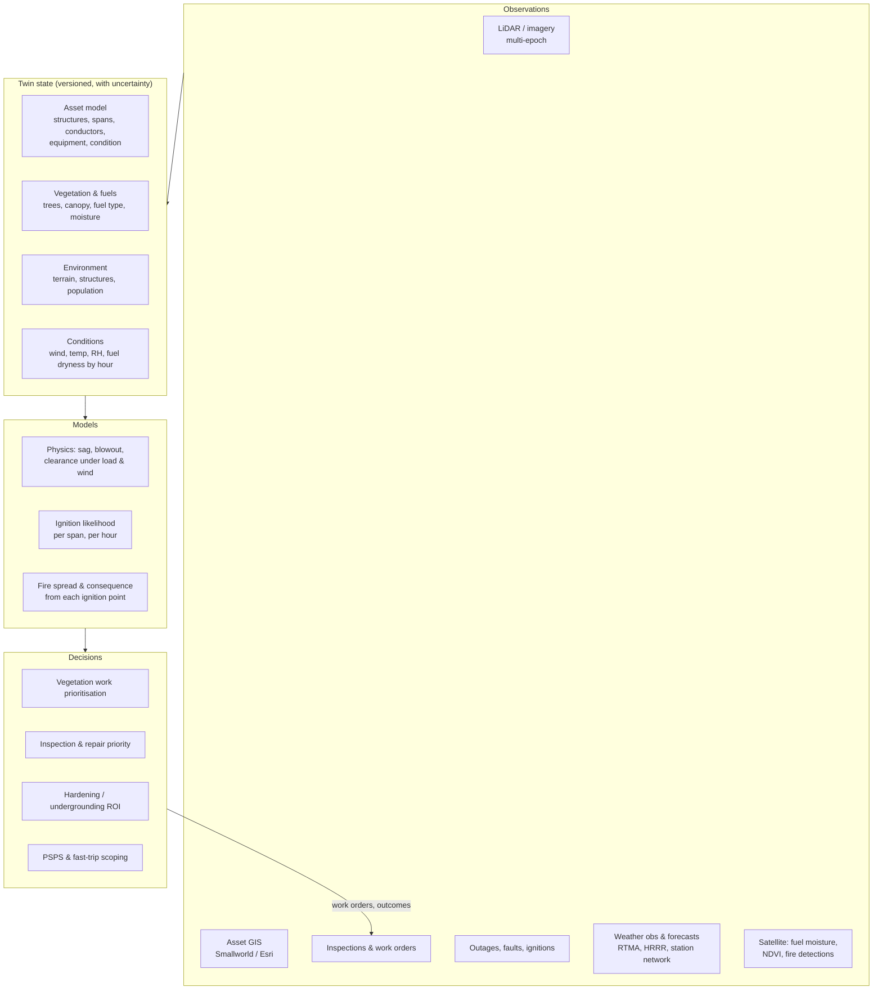

# RFC 0001: A wildfire-risk digital twin for Xcel Energy's grid

| | |
|---|---|
| **Status** | Draft. Open for comment |
| **Author** | Matt Jorden |
| **Created** | 2026-10-20 |
| **Builds on** | `vegrisk` (this repository): LiDAR grow-in / fall-in screening |

## Summary

This RFC sets out what we mean by a *digital twin for wildfire risk* on Xcel Energy's electric infrastructure, what one would contain, and a phased plan to build it from scratch. It starts from what this repository already does: a static, one-off vegetation screen of a single corridor. It ends at a twin that is kept in sync with the network and can answer three questions for any span at any hour:

1. **How likely is this span to start a fire?** (ignition likelihood)
2. **If it did, how bad would the fire be?** (consequence)
3. **Which action reduces that risk most per dollar or per customer-hour?** (decision support)

The RFC's main argument is that a twin is defined by **state, time and feedback**, not by 3D rendering. A point cloud you can fly through is a model. A twin knows what each asset looks like *now*, how sure it is, what the weather is doing to it, and it is corrected when crews, sensors or new surveys report back.

## Motivation

- **The exposure is real and concentrated.** Xcel serves wildland–urban interface territory along the Colorado Front Range and grassland in the Texas and New Mexico Panhandle. The December 2021 Marshall Fire (Boulder County) and the February 2024 Smokehouse Creek Fire (Texas Panhandle) have both been linked by investigators or by the company to Xcel equipment. Liability, insurance and regulatory pressure now follow from that.
- **Regulators expect quantified, span-level risk.** Wildfire Mitigation Plans, and the risk models behind them, are moving towards per-asset ignition probability × consequence, with tracked mitigation effectiveness. California's mature process (CPUC / Office of Energy Infrastructure Safety) is a good guide to where Colorado and other states are heading.
- **Decisions are made at span granularity, but data lives in silos.** GIS (Smallworld / Esri), inspection records, outage history, LiDAR deliveries, vegetation work orders and weather feeds each describe part of the same span. Nobody can query them together "as of" a date.
- **This repository shows the failure mode of skipping the twin.** In the Nashville case study, building a canopy model straight from vendor classes flags 39 of 39 segments as grow-in, because the vendor labelled the conductors as vegetation. Removing them gives 0. A twin that carries provenance and uncertainty with every layer turns that kind of error from a silent mistake into a visible flag.

## What we mean by a "digital twin"

Working definition:

> A **wildfire-risk digital twin** is a versioned, spatially explicit representation of the network and its surroundings, with each element's current state and uncertainty, coupled to physical and statistical models of how that state turns into ignition and fire consequence under given conditions. It is updated from observations and from the actions taken on it.

Four properties separate it from a GIS layer or a one-off risk study:

| Property | Means | Test |
|---|---|---|
| **Stateful** | Every asset and tree has a current condition, not just a geometry | "What is the clearance on span X?" has one answer, with a date |
| **Temporal** | State is versioned; you can query *as-of* and *what-if* | "What did we believe about span X before the 2025 trim?" |
| **Uncertain** | Every value carries provenance and confidence; unknowns stay unknown | Segments are `measured`, `robust` or `bound-dependent`, as in `vegrisk` today |
| **Closed-loop** | Field outcomes, new surveys and sensor data update the state and recalibrate the models | A completed trim work order changes the canopy layer before the next LiDAR flight |

### Non-goals (for now)

- Real-time grid control or protection settings. The twin *recommends* (e.g. PSPS scope, fast-trip settings); operators and existing systems act.
- Fire suppression operations or evacuation modelling.
- Replacing commercial platforms (Neara, Technosylva and the like) outright. The twin should be able to consume or feed them, and to check them independently.
- Photorealistic visualisation as an end in itself.

## What it would look like

### Layers

### Core entities

The twin's spine is a network graph with a small number of entity types. Every entity row carries `valid_from`, `valid_to`, `source`, and a confidence or bounds field.

| Entity | Key attributes | Primary source |
|---|---|---|
| `Structure` | type, material, height, install year, condition, attachments | Asset GIS, inspections, LiDAR |
| `Span` | from/to structures, voltage, conductor type, length, ruling span, covered/bare | Asset GIS |
| `ConductorState` | 3D catenary at reference conditions, sag/tension parameters, measured or bounded | LiDAR + sag model |
| `Equipment` | transformers, fuses (expulsion vs non-expulsion), reclosers and their settings | Asset GIS, protection DB |
| `Tree` | location, height, crown, species group, lean, health, distance to conductor | LiDAR, imagery, veg inspections |
| `FuelCell` | fuel model, canopy cover / base height, live and dead fuel moisture | LANDFIRE, satellite, field |
| `ConditionsCell` | wind speed/gust/direction, temp, RH, fire-weather indices, by hour | RTMA, HRRR, utility stations |
| `RiskScore` | P(ignition), consequence, risk, drivers, model version, as-of time | Twin models |
| `Action` | trim, removal, repair, replace, reconductor, underground, PSPS event | Work management |

### Risk formulation

Following common utility practice, risk for span *s* at time *t* is

$$
R(s, t) = P(\text{ignition} \mid s, t) \times \mathbb{E}[\text{consequence} \mid \text{ignition at } s, t]
$$

- **Ignition likelihood** is decomposed by driver: vegetation contact (grow-in, fall-in, blow-in), equipment failure (pole, conductor, splice, connector, transformer, expulsion fuse), conductor clash, and contact by animals or third parties. Each driver has its own model and inputs, so a mitigation can be credited against the driver it actually addresses.
- **Consequence** is the expected impact of a fire started at *s* under conditions *t*: an unsuppressed spread simulation over a fixed window (e.g. 8 h), intersected with structures, population and critical facilities.
- **Every output is a distribution or an interval, not a point estimate.** The bounded-conductor approach in `vegrisk` generalises: a span whose answer flips within its uncertainty is labelled as such, and is a candidate for better data rather than for immediate field work.

### Users and the questions they ask

| User | Question | Twin answer |
|---|---|---|
| Vegetation management | Which spans need trimming before fire season, and which trees? | Ranked spans, tree list, cost estimate, confidence |
| Asset / reliability | Which poles and equipment carry the most ignition risk? | Driver-specific P(ignition), condition trends |
| Capital planning | Underground, covered conductor, or trim cycle here? | Risk reduction per dollar for each option, over 10–20 years |
| Emergency / grid ops | Which circuits exceed the PSPS threshold in the next 72 h? | Hourly forecast risk per span, customers affected, critical loads |
| Regulatory | Show us the risk model and how mitigations performed | Versioned models, back-tests, as-of snapshots |

## Roadmap

Each phase ends in something usable on its own, so the work can stop or be redirected at any phase boundary without being wasted. Phases 0–3 are possible with **public data only** and form a credible demonstration. Phases 4 onward need utility data and partnership.

### Phase 0: Scope and foundations

- Agree on definitions in this RFC: risk formula, entity model, uncertainty conventions, units (metres internally, with explicit CRS-unit conversion, as `vegrisk` already does).
- Pick a **pilot region**: a Front Range corridor in Xcel Colorado territory with WUI exposure and public 3DEP coverage, ideally including both transmission and distribution.
- Decide the storage and compute model. Candidate: Delta tables on Databricks (or GeoParquet + DuckDB locally) with H3 or span-ID keys and bitemporal versioning.
- **Exit:** signed-off entity schema; pilot boundary; a public-data inventory.

### Phase 1: Static asset + vegetation twin (public data)

Generalise `vegrisk` from "a study" to "a state store".

- Ingest 3DEP LiDAR, OSM / public transmission line data, LANDFIRE fuels, Microsoft / OSM building footprints, NAIP imagery.
- Run the existing pipeline (conductor extraction, bounded conductor profile, conductor-return removal, grow-in / fall-in) across all lines in the pilot and **write results into the entity tables** instead of one-off GeoPackages.
- Add individual-tree segmentation with species group from imagery, and store `Tree` entities with provenance.
- Build a hand-labelled test set (the gap named in this repo's Limitations) so wire and structure accuracy is measured against truth rather than against the labelling rules.
- **Exit:** queryable state for every span in the pilot: clearance, strike trees, confidence label, data vintage.

### Phase 2: Physics layer: conductors under real conditions

LiDAR captures the conductor at one temperature and one wind. Risk depends on the worst case.

- Fit sag–tension (ruling-span) parameters per span from measured catenaries; infer conductor temperature at flight time from weather and estimated load.
- Model **sag under high load / temperature** (IEEE 738 thermal model) and **blowout under wind**, and recompute clearance envelopes as a function of conditions.
- Re-score grow-in, fall-in and blow-in against the *conditional* conductor position, not the as-flown one.
- Check against the code envelopes (NESC clearances; NERC FAC-003 MVCD for applicable transmission).
- **Exit:** clearance(span, wind, temperature) available as a function, validated against spans flown on more than one date.

### Phase 3: Consequence layer

- Run fire spread from candidate ignition points along every span under a set of historical worst-case weather scenarios (open options: ELMFIRE, FlamMap / FARSITE; Wildfire Risk to Communities as a cross-check).
- Intersect with buildings, population, critical facilities and egress routes to get consequence per span per scenario.
- Back-test: reconstruct conditions for Marshall (2021) and check that the consequence layer ranks the affected area highly.
- **Exit:** consequence score per span with scenario spread; a first public-data **relative risk map**: vegetation-driven likelihood × consequence.

### Phase 4: Ignition likelihood from utility data

This is where public data stops being enough.

- Join utility outage, fault and ignition history to spans; join inspection findings and asset age / condition.
- Train driver-specific likelihood models (e.g. gradient-boosted or Bayesian hierarchical models over spans × weather), calibrated to rare events. Publicly reported California utility ignition data can provide priors and transfer tests.
- Validate with **spatially and temporally blocked** splits; this repository already shows random splits overstating skill by orders of magnitude on spatial data. Report calibration (reliability curves), not just ranking metrics.
- **Exit:** calibrated P(ignition | span, conditions) with driver attribution; full risk = likelihood × consequence across the pilot.

### Phase 5: Make it dynamic

- Ingest hourly observations and forecasts (RTMA, HRRR, utility weather stations) and satellite fuel-moisture estimates.
- Produce a **72-hour forecast risk** per span and per circuit, with uncertainty from forecast ensembles.
- Prototype PSPS / fast-trip decision support: customers and critical loads affected versus risk avoided, with the reasoning shown.
- Back-test against past PSPS events and red-flag days.
- **Exit:** a daily (then hourly) automated run that operations staff can read during fire season.

### Phase 6: Close the loop

- Feed completed work orders (trims, removals, replacements) back into state immediately, with an expected regrowth model until the next survey confirms.
- Multi-epoch change detection from repeat LiDAR and imagery: regrowth rates by species and site, new hazards, structure lean.
- Track **mitigation effectiveness**: did risk fall where we acted, and did outages and ignitions follow?
- Automatically recalibrate models as new outcomes arrive, with versioned model releases.
- **Exit:** a twin whose state is maintained by operations, not rebuilt by analysts.

### Phase 7: Optimise and scale

- Portfolio optimisation: choose the mix of trimming, hardening, covered conductor, undergrounding and operational settings that minimises risk under a budget and a reliability constraint, across multi-year horizons.
- Scale from pilot to the full Colorado service territory, then to the SPS (Texas / New Mexico) and NSP systems, where the fuel and fire regimes differ (grassland vs forest), so models are re-validated per region rather than assumed to transfer. (In this repo, the Colorado classifier recalled 0% of Nashville's conductors.)
- Integrate with enterprise systems (GIS, work management, outage management) and, where they exist, commercial twins.

## Risks and open questions

- **Distribution coverage.** Most utility ignitions start on distribution lines, which are poorly represented in OSM and harder to see in 8–35 pts/m² LiDAR. Public-data phases mainly cover transmission; the twin's value depends on getting utility distribution GIS early.
- **Rare-event validation.** Ignitions are rare and clustered in a few extreme days. How do we demonstrate skill without overfitting to Marshall and Smokehouse Creek?
- **Data vintage.** 3DEP acquisitions in the pilot may be years old. How should state confidence decay with time since survey, and how do we price a resurvey against that decay?
- **Build vs buy.** Which layers should be built (to keep transparency and auditability) and which bought (spread modelling, fuels, imagery analytics)?
- **Sensitivity of outputs.** Span-level risk scores for named utility assets are sensitive. What can be public (methods, public-data pilot) and what must stay inside the utility?
- **Units and CRS.** Front Range data mixes UTM metres and Colorado State Plane US survey feet. The `las_m_per_unit()` convention must be enforced at every ingest.

## Feedback requested

1. Is the working definition of "twin" right, especially the four properties table, or is it too narrow?
2. Is span the right primary key, or should the twin key on circuit segments between protective devices (what PSPS actually operates on)?
3. Which pilot corridor should Phase 1 use?
4. What should Phase 3's public-data risk map be measured against, to count as a credible demonstration?
