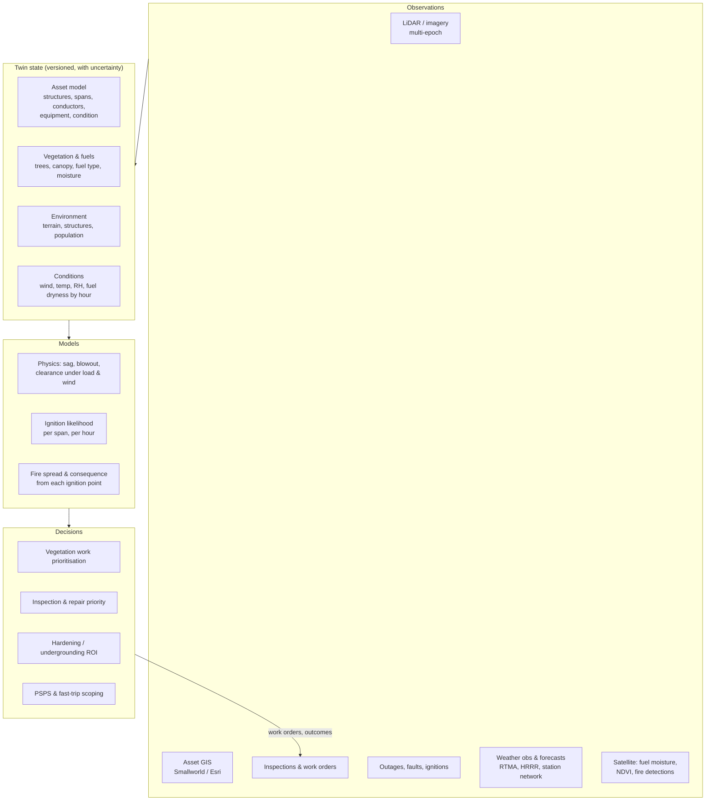
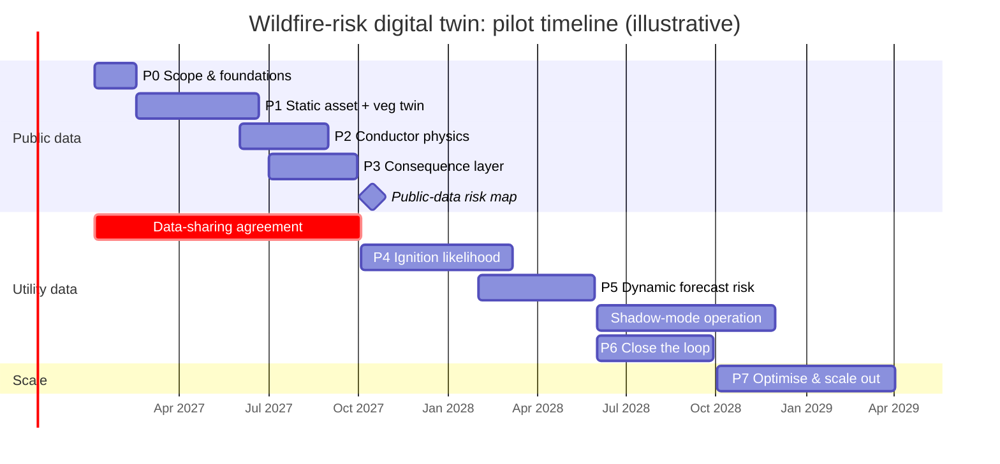

# RFC 0001: A wildfire-risk digital twin for Xcel Energy's grid

| | |
|---|---|
| **Status** | Draft, revised. Open for comment |
| **Author** | Matt Jorden |
| **Created** | 2026-10-20 |
| **Revised** | 2026-10-21: Colorado regulatory context, a fifth twin property (identity), bitemporal state, span vs section decided, a concrete Phase 1 pilot with acceptance tests, answers to the feedback questions. Based on the review in RFC 0002. |
| **Builds on** | `vegrisk` (this repository): LiDAR grow-in / fall-in screening |

## Summary

This RFC sets out what we mean by a *digital twin for wildfire risk* on Xcel Energy's electric infrastructure, what one would contain, and a phased plan to build it from scratch. It starts from what this repository already does: a static, one-off vegetation screen of a single corridor. It ends at a twin that is kept in sync with the network and can answer three questions for any span at any hour:

1. **How likely is this span to start a fire?** (ignition likelihood)
2. **If it did, how bad would the fire be?** (consequence)
3. **Which action reduces that risk most per dollar or per customer-hour?** (decision support)

The RFC's main argument is that a twin is defined by **state, time and feedback**, not by 3D rendering. A point cloud you can fly through is a model. A twin knows what each asset looks like *now*, how sure it is, what the weather is doing to it, and it is corrected when crews, sensors or new surveys report back.

## Motivation

- **The exposure is real and concentrated.** Xcel serves wildland–urban interface territory along the Colorado Front Range and grassland in the Texas and New Mexico Panhandle. The December 2021 Marshall Fire (Boulder County) and the February 2024 Smokehouse Creek Fire (Texas Panhandle) have both been linked by investigators or by the company to Xcel equipment. Liability, insurance and regulatory pressure now follow from that.
- **Regulators expect quantified, span-level risk.** Wildfire Mitigation Plans, and the risk models behind them, are moving towards per-asset ignition probability × consequence, with tracked mitigation effectiveness. California's process (Public Utilities Code 8386-8387; Energy Safety's 2026-2028 guidelines) has a three-year-plan-plus-annual-update structure, and Colorado's proposed rules have a similar shape (see "Colorado context" below).
- **Decisions are made at span granularity, but data lives in silos.** GIS (Smallworld / Esri), inspection records, outage history, LiDAR deliveries, vegetation work orders and weather feeds each describe part of the same span. Nobody can query them together "as of" a date.
- **This repository shows the failure mode of skipping the twin.** In the Nashville case study, building a canopy model straight from vendor classes flags 39 of 39 segments as grow-in, because the vendor labelled the conductors as vegetation. Removing them gives 0. A twin that carries provenance and uncertainty with every layer turns that kind of error from a silent mistake into a visible flag.

## Colorado context (as of 21 October 2026)

Sourced in RFC 0002 Part 2. The points that shape this RFC:

- **No Colorado statute or rule has required Wildfire Mitigation Plans to date.** Xcel filed its 2020 and 2025-2027 plans voluntarily. On 23 September 2026 the Public Utilities Commission opened **rulemaking 26R-0355E**, applying to Xcel (Public Service Company of Colorado) and Black Hills Energy: a full plan every three years, annual progress reports, performance data twice a year, a PSPS plan every three years with PSPS as a last resort. The proposed content is an assessment of wildfire likelihood and consequence tied to utility equipment, high-risk areas identified, the assessments **independently checked**, mitigation options compared by cost, risk reduction and reliability, and coverage of inspections, vegetation management, system improvements and emergency preparedness. Comments were due 2 November 2026 and a hearing is set for 23 November. The summaries available do not mention span-level modelling, LiDAR or digital twins; the hook for this RFC is "likelihood and consequence tied to equipment" plus the independent check, which is what provenance and versioned state are for.
- **Xcel's 2025-2027 plan** (Proceeding 24A-0296E) was approved by settlement on 5 June 2025 at about $1.9B, including about 50 miles of targeted undergrounding. Its risk model is Technosylva Wildfire Analyst Enterprise plus an independently built three-tier territory map that replaced the earlier Wildfire Risk Zone (about 2,100 of 9,500 distribution feeder miles and 2,800 of 5,000 transmission miles). LiDAR is already used on distribution lines for pole loading and clearance. Xcel's first Colorado PSPS was in April 2024. The Marshall Fire litigation settled on 24 September 2025 for about $640M without an admission of fault.
- **The co-ops are further along on public method than expected.** CORE Electric Cooperative's 2026 plan uses CSFS CO-WRA 2023 layers and Technosylva Wildfire Ops with simulated ignitions every 100 m of line and a six-year vegetation cycle. Any public-data demonstration here will be compared with that.
- **Data.** The Front Range WUI has 3DEP coverage (`CO_DRCOG_2020_B20` QL1/QL2 with **no vegetation classes**, plus Arapaho-Roosevelt-Pike 2023, CONM gaps 2024, Cameron Peak 2021). **HIFLD Open was discontinued in August 2025**, so transmission geometry comes from OSM, EIA or the utility. CSFS CO-WRA's 2022 update (released 2023) is on a five-year cycle; LANDFIRE LF 2024 is version 2.5.0. Colorado State Plane North, Central and South zones are in US survey feet with NAVD88; DRCOG 2020 is UTM 13N metres.
- **Standards:** NESC 2023 (IEEE C2-2023); NERC FAC-003-5 (enforceable April 2024); IEEE 738 for conductor temperature. FAC-003's minimum vegetation clearance distance is altitude-dependent, which matters on the Front Range.

## What we mean by a "digital twin"

Working definition:

> A **wildfire-risk digital twin** is a versioned, spatially explicit representation of the network and its surroundings, with each element's current state and uncertainty, coupled to physical and statistical models of how that state turns into ignition and fire consequence under given conditions. It is updated from observations and from the actions taken on it.

Five properties separate it from a GIS layer or a one-off risk study:

| Property | Means | Test |
|---|---|---|
| **Identified** | Every entity has a stable key across runs, epochs and sources, with explicit match records between epochs | "The same tree in the 2020 and 2024 LiDAR is one `tree_id`, or a match row says why not." `vegrisk` fails this today: `seg_id` restarts at 1 per run and `tree_id` depends on the CRS |
| **Stateful** | Every asset and tree has a current condition, not just a geometry | "What is the clearance on span X?" has one answer, with a date |
| **Temporal** | State is **bitemporal**: valid time (when the world was like this, from the survey date) and transaction time (when we recorded it), so both *as-of* questions work | "What was the canopy in 2020?" (valid time) and "What did we believe about span X before the 2025 trim?" (transaction time) |
| **Uncertain** | Every value carries provenance and an interval or confidence; unknowns stay unknown; hard bounds from missing data are kept apart from stochastic error; confidence decays with time since survey | The conductor is an interval [`z_lo`, `z_hi`] with a `measured` / `robust` / `bound-dependent` summary, as in `vegrisk` today, and every derived metric carries its own interval |
| **Closed-loop** | Field outcomes, new surveys and sensor data update the state and recalibrate the models | A completed trim work order changes the canopy layer before the next LiDAR flight. Not testable in the public-data phases, and the demonstration should not be judged against it |

### Non-goals (for now)

- Real-time grid control or protection settings. The twin *recommends* (e.g. PSPS scope, fast-trip settings); operators and existing systems act.
- Fire suppression operations or evacuation modelling.
- Replacing commercial platforms (Neara, Technosylva and the like) outright. The twin should be able to consume or feed them, and to check them independently.
- Photorealistic visualisation as an end in itself.

## What it would look like

### Layers

### Core entities

The twin's spine is a network graph with a small number of entity types. Every entity row carries `valid_from`, `valid_to`, `source`, and a confidence or bounds field.

| Entity | Key attributes | Primary source |
|---|---|---|
| `Structure` | type, material, height, install year, condition, attachments | Asset GIS, inspections, LiDAR |
| `Span` | from/to structures, voltage, conductor type, length, ruling span, covered/bare | Asset GIS |
| `ConductorState` | 3D catenary at reference conditions, sag/tension parameters, measured or bounded | LiDAR + sag model |
| `Equipment` | transformers, fuses (expulsion vs non-expulsion), reclosers and their settings | Asset GIS, protection DB |
| `Tree` | location, height, crown, species group, lean, health, distance to conductor | LiDAR, imagery, veg inspections |
| `FuelCell` | fuel model, canopy cover / base height, live and dead fuel moisture | LANDFIRE, satellite, field |
| `ConditionsCell` | wind speed/gust/direction, temp, RH, fire-weather indices, by hour | RTMA, HRRR, utility stations |
| `RiskScore` | P(ignition), consequence, risk, drivers, model version, as-of time | Twin models |
| `Action` | trim, removal, repair, replace, reconductor, underground, PSPS event | Work management |

### Risk formulation

Following common utility practice, risk for span *s* at time *t* is

$$
R(s, t) = P(\text{ignition} \mid s, t) \times \mathbb{E}[\text{consequence} \mid \text{ignition at } s, t]
$$

- **Ignition likelihood** is decomposed by driver: vegetation contact (grow-in, fall-in, blow-in), equipment failure (pole, conductor, splice, connector, transformer, expulsion fuse), conductor clash, and contact by animals or third parties. Each driver has its own model and inputs, so a mitigation can be credited against the driver it actually addresses.
- **Consequence** is the expected impact of a fire started at *s* under conditions *t*: an unsuppressed spread simulation over a fixed window (e.g. 8 h), intersected with structures, population and critical facilities.
- **Every output is a distribution or an interval, not a point estimate.** The bounded-conductor approach in `vegrisk` generalises: a span whose answer flips within its uncertainty is labelled as such, and is a candidate for better data rather than for immediate field work.

### Users and the questions they ask

| User | Question | Twin answer |
|---|---|---|
| Vegetation management | Which spans need trimming before fire season, and which trees? | Ranked spans, tree list, cost estimate, confidence |
| Asset / reliability | Which poles and equipment carry the most ignition risk? | Driver-specific P(ignition), condition trends |
| Capital planning | Underground, covered conductor, or trim cycle here? | Risk reduction per dollar for each option, over 10–20 years |
| Emergency / grid ops | Which circuits exceed the PSPS threshold in the next 72 h? | Hourly forecast risk per span, customers affected, critical loads |
| Regulatory | Show us the risk model and how mitigations performed | Versioned models, back-tests, as-of snapshots |

## Roadmap

Each phase ends in something usable on its own, so the work can stop or be redirected at any phase boundary without being wasted. Phases 0–3 are possible with **public data only** and form a credible demonstration. Phases 4 onward need utility data and partnership.

### Phase 0: Scope and foundations

- Agree on definitions in this RFC: risk formula, entity model, uncertainty conventions, units (metres internally, with explicit CRS-unit conversion, as `vegrisk` already does), and the **key convention**: span as primary key, protective-device sections as a versioned grouping (see "Decisions" below).
- **Pilot region (proposed):** the Boulder County foothills, from Sunshine Canyon, Fourmile Canyon and lower Boulder Canyon west of Boulder south-east to Marshall Mesa, Superior and Louisville, intersected with the `CO_DRCOG_2020` footprint. It holds the existing Sunshine baseline (OSM way 1381464850, operator Public Service Company of Colorado) as a regression anchor, combines forest WUI (Fourmile Canyon Fire, 2010) with grassland WUI (Marshall, 2021), predates Marshall so it gives the pre-fire state for the Phase 3 back-test, and sits in State Plane North so county deliveries exercise the US-survey-feet path. Candidate lines are selected by query (`power=line|minor_line` with an Xcel/PSCo operator), cross-checked against the PUC service-territory layer because co-ops serve parts of the foothills. Target about 30-60 km of transmission plus whatever distribution OSM maps; measure `minor_line` coverage against NAIP before claiming the pilot covers distribution.
- Decide the storage and compute model. Default: GeoParquet in EPSG:6342 (NAD83(2011) / UTM 13N, metres) partitioned by `run_id`, queried with DuckDB, with `valid_from`/`valid_to`/`recorded_at`/`superseded_at` on every row; Delta on Databricks later if the utility's platform demands it.
- Fix the three scientific findings that change what a span's state means (RFC 0002 A1-A3) before anything is built on the outputs.
- **Exit:** signed-off entity schema and key convention; pilot boundary; a public-data inventory; the run manifest in use.

### Phase 1: Static asset + vegetation twin (public data)

Generalise `vegrisk` from "a study" to "a state store".

- Ingest 3DEP LiDAR, OSM / public transmission line data, LANDFIRE fuels, Microsoft / OSM building footprints, NAIP imagery.
- Run the existing pipeline (conductor extraction, bounded conductor profile, conductor-return removal, grow-in / fall-in) across all lines in the pilot and **write results into the entity tables** instead of one-off GeoPackages.
- Add individual-tree segmentation with species group from imagery, and store `Tree` entities with provenance.
- Build a hand-labelled test set by the protocol in RFC 0002 Part 3 (whole spans, stratified before results are seen, buffered from training blocks, double-labelled with kappa), so wire and structure accuracy is measured against truth rather than against the labelling rules.
- Re-key on structure-to-structure spans (structure table from OSM nodes plus a LiDAR column check; lines split at structures; station metrics aggregated per span), read GPS time for data vintage, and move from the per-site script to a chunked `vegrisk_run(corridor, inputs, params, store)`; the distribution parameter presets and through-canopy conductor detector are part of this phase.

**Deliverable tables** (every row with `run_id`, `valid_from`, `valid_to`, `recorded_at`, `source`, `source_version`, `method_version` and a bounds or confidence field): `runs`, `structure`, `span`, `span_station`, `conductor_state`, `tree`, `span_veg_state`, `fuel_cell`, `conditions_cell`, `label_set`.

**Acceptance tests:**
1. Every span in the boundary has a `span_veg_state` row with non-null `confidence` and `valid_from`; a span without LiDAR gets a `low coverage` row, never a missing row.
2. Re-running Sunshine inside the pilot and aggregating back to 50 m stations reproduces the case study (3 robust grow-in, 27 bound-dependent, 33 and 322 strike trees).
3. The same tiles reprojected to Colorado North US survey feet give identical span tiers and tree ids, with clearance within 0.05 m.
4. Two runs on identical inputs give byte-identical tables apart from `run_id` and `recorded_at`.
5. After a second run with changed inputs, an as-of query at the first run's `recorded_at` returns the first run's rows exactly.
6. At least 95% of OSM structures snap to a span end; spans longer than the plausible maximum are flagged and get no upper bound.
7. Wire precision, recall and AP are reported against the labelled set with a fold-level spread, separately for transmission and distribution; conductor elevation error against labelled points on measured spans (median |dz| <= 0.5 m).
8. The top 20 robust grow-in spans and a random 20 `none` spans are checked against NAIP or in the field; hit and miss rates reported.
9. The full pilot runs in bounded memory on one workstation within a stated wall-clock budget.

- **Exit:** queryable state for every span in the pilot: clearance, strike trees, confidence label, data vintage; the nine tests pass.

### Phase 2: Physics layer: conductors under real conditions

LiDAR captures the conductor at one temperature and one wind. Risk depends on the worst case.

- First, the cheap conservative step that fits the bounds philosophy: a parabola per measured span and a maximum-temperature sag from the design temperature minus the estimated flight temperature (ERA5 temperature at the GPS flight time, IEEE 738 with an assumed load fraction), ignoring elastic stretch so the result is a lower bound on the conductor; then blowout from a design wind pressure as a lateral band. This needs the span keys, attachment heights, conductor type (OSM `cables`/`wires` or a per-voltage default family) and flight time that Phase 1 provides.

- Fit sag–tension (ruling-span) parameters per span from measured catenaries; infer conductor temperature at flight time from weather and estimated load.
- Model **sag under high load / temperature** (IEEE 738 thermal model) and **blowout under wind**, and recompute clearance envelopes as a function of conditions.
- Re-score grow-in, fall-in and blow-in against the *conditional* conductor position, not the as-flown one.
- Check against the code envelopes (NESC clearances; NERC FAC-003 MVCD for applicable transmission).
- **Exit:** clearance(span, wind, temperature) available as a function, validated against spans flown on more than one date.

### Phase 3: Consequence layer

- Run fire spread from candidate ignition points along every span under a set of historical worst-case weather scenarios (open options: ELMFIRE, FlamMap / FARSITE; Wildfire Risk to Communities as a cross-check).
- Intersect with buildings, population, critical facilities and egress routes to get consequence per span per scenario.
- Back-test: reconstruct conditions for Marshall (2021) and check that the consequence layer ranks the affected area highly.
- **Exit:** consequence score per span with scenario spread; a first public-data **relative risk map**: vegetation-driven likelihood × consequence.

### Phase 4: Ignition likelihood from utility data

This is where public data stops being enough.

- Join utility outage, fault and ignition history to spans; join inspection findings and asset age / condition.
- Train driver-specific likelihood models (e.g. gradient-boosted or Bayesian hierarchical models over spans × weather), calibrated to rare events. Publicly reported California utility ignition data can provide priors and transfer tests.
- Validate with **spatially and temporally blocked** splits; this repository already shows random splits overstating skill by orders of magnitude on spatial data. Report calibration (reliability curves), not just ranking metrics.
- **Exit:** calibrated P(ignition | span, conditions) with driver attribution; full risk = likelihood × consequence across the pilot.

### Phase 5: Make it dynamic

- Ingest hourly observations and forecasts (RTMA, HRRR, utility weather stations) and satellite fuel-moisture estimates.
- Produce a **72-hour forecast risk** per span and per circuit, with uncertainty from forecast ensembles.
- Prototype PSPS / fast-trip decision support: customers and critical loads affected versus risk avoided, with the reasoning shown.
- Back-test against past PSPS events and red-flag days.
- **Exit:** a daily (then hourly) automated run that operations staff can read during fire season.

### Phase 6: Close the loop

- Feed completed work orders (trims, removals, replacements) back into state immediately, with an expected regrowth model until the next survey confirms.
- Multi-epoch change detection from repeat LiDAR and imagery: regrowth rates by species and site, new hazards, structure lean.
- Track **mitigation effectiveness**: did risk fall where we acted, and did outages and ignitions follow?
- Automatically recalibrate models as new outcomes arrive, with versioned model releases.
- **Exit:** a twin whose state is maintained by operations, not rebuilt by analysts.

### Phase 7: Optimise and scale

- Portfolio optimisation: choose the mix of trimming, hardening, covered conductor, undergrounding and operational settings that minimises risk under a budget and a reliability constraint, across multi-year horizons.
- Scale from pilot to the full Colorado service territory, then to the SPS (Texas / New Mexico) and NSP systems, where the fuel and fire regimes differ (grassland vs forest), so models are re-validated per region rather than assumed to transfer. (In this repo, the Colorado classifier recalled 0% of Nashville's conductors.)
- Integrate with enterprise systems (GIS, work management, outage management) and, where they exist, commercial twins.

## Rough timeline

**Team:** two data scientists (DS) and two GIS technicians (GIS). Dates are illustrative, assuming a start in January 2027. Durations are calendar time for this team, with roughly 25% contingency built in; they are planning estimates, not commitments.

**Headline:** a public-data risk map for the pilot at about **month 9–10**; a calibrated, dynamic twin running in shadow mode at about **month 17**; a closed-loop pilot twin at about **month 21**. Territory-wide scale-out is a further year or more.

| Phase | Months | DS focus | GIS focus |
|---|---|---|---|
| **P0** Scope & foundations | 0–1.5 | Schema, risk formulation, storage / compute choice | Public-data inventory, pilot boundary, CRS and unit conventions; **start the utility data-sharing request** |
| **P1** Static twin | 1.5–5.5 | Generalise `vegrisk` into a state store; tree segmentation and species grouping | Ingest and conflate lines and structures; hand-label the LiDAR test set; QA of tree and conductor outputs |
| **P2** Conductor physics | 5–8 | DS-A: sag–tension fitting, IEEE 738, wind blowout, conditional clearance | Find spans flown on more than one date; assemble structure and conductor attributes |
| **P3** Consequence | 6–9 | DS-B: fire-spread runs, scenario selection, Marshall back-test | Exposure layers: buildings, population, critical facilities, egress routes |
| **P4** Ignition likelihood | 9–14 | Both: driver-specific models, rare-event calibration, blocked validation | Join outage, fault, ignition and inspection records to spans (the bulk of the work) |
| **P5** Dynamic risk | 13–17 | Weather / fuel-moisture ingest, ensemble forecast risk, PSPS scoping logic | Circuit and protective-device topology; customer and critical-load mapping |
| Shadow mode | 17–23 | Compare forecasts against observed events and operator decisions; fix what breaks | Operator-facing maps and daily products |
| **P6** Close the loop | 17–21 | Regrowth model, change detection, mitigation-effectiveness tracking | Work-order integration; multi-epoch LiDAR / imagery change mapping |
| **P7** Optimise & scale | 21+ | Portfolio optimisation; re-validate models per region | Territory-wide ingest and conflation, one operating company at a time |

### What drives the schedule

- **The data-sharing agreement is the critical path.** Phase 4 can't start without outage, ignition, inspection and asset GIS data. Start the request in Phase 0; if it lands later than month 9, the public-data phases can absorb a short delay but Phase 4 slips day for day.
- **Two DS can run P2 and P3 in parallel, but not much else.** Each owns one phase from month 5. Any extra scope in that window (e.g. distribution LiDAR, a second pilot) pushes the public-data milestone.
- **Conflation is GIS-heavy and usually underestimated.** Matching utility records to spans, and utility GIS to what LiDAR shows, is the main GIS workload in P1 and P4.
- **Nobody on this team owns production engineering.** P5 onward runs daily or hourly on a schedule that operations rely on. Plan for at least part-time data or platform engineering support from about month 12; without it, expect P5–P6 to take roughly twice as long, and the DS to spend their time on pipelines.
- **Fire seasons set the deadlines that matter.** Shadow mode should cover a full year: summer fire season and the Front Range winter wind season (Marshall was a December fire). Missing the June 2028 start pushes operational use back by a year, not by a few weeks.
- **Field verification needs crews we don't control.** Checking strike trees and model outputs on the ground depends on vegetation contractors' schedules; book it early.

## Decisions taken in this revision

- **Span is the primary key; protective-device sections are a versioned many-to-one grouping** (`section_membership(span_id, section_id, valid_from, valid_to, switching_state)`). Physics, vegetation work, inspections and trims are span-level; sections change with switching state and device additions, and keying on them would force re-keying the history. PSPS risk is an aggregation over the grouping (for independent spans, 1 − ∏(1 − p_span), plus the maximum span and the driver mix). Within a span the 1 m stations stay as a child table because crews need the tree's location.
- **Bitemporal state and a fifth property, identity**, as in the properties table.
- **The Phase 3 public-data map is validated for consequence and vegetation-contact exposure, not for ignition likelihood**, because Colorado utility ignition records are not public. The Marshall back-test must say up front that the investigated ignition was an equipment failure in a downslope grassland wind, not a tree contact, so the vegetation layer correctly does not rank that span highly; the consequence layer is what the back-test tests, against a trivial baseline (building count within a radius times burn probability) that it must beat.
- **A map whose top decile is mostly bound-dependent is a resurvey list, not a risk map**, and will be presented as such.

## Risks and open questions

- **Distribution coverage.** Most utility ignitions start on distribution lines, which are poorly represented in OSM and harder to see in 8–35 pts/m² LiDAR. Public-data phases mainly cover transmission; the twin's value depends on getting utility distribution GIS early.
- **Rare-event validation.** Ignitions are rare and clustered in a few extreme days. How do we demonstrate skill without overfitting to Marshall and Smokehouse Creek?
- **Data vintage.** 3DEP acquisitions in the pilot may be years old. How should state confidence decay with time since survey, and how do we price a resurvey against that decay?
- **Build vs buy.** Which layers should be built (to keep transparency and auditability) and which bought (spread modelling, fuels, imagery analytics)?
- **Sensitivity of outputs.** Span-level risk scores for named utility assets are sensitive. What can be public (methods, public-data pilot) and what must stay inside the utility?
- **Units and CRS.** Front Range data mixes UTM metres and Colorado State Plane US survey feet. The `las_m_per_unit()` convention must be enforced at every ingest.

## Feedback requested

The four questions in the first draft are answered above (identity and bitemporal state added to the definition; span as key with sections as a grouping; the Boulder County foothills pilot; consequence and exposure validation with a pre-registered baseline). Open now:

1. Does the utility's own asset GIS key on spans, structures or circuit sections, and what is its structure identifier? The conflation plan depends on it.
2. Is the Boulder County foothills boundary inside Public Service Company of Colorado territory span by span, or do United Power, Poudre Valley REA or IREA serve parts of it?
3. Which earlier LiDAR epochs exist over the pilot (post-2013-flood county flights, city deliveries) for the Phase 2 validation on spans flown twice?
4. What does 26R-0355E's rule text say about the independent check: scope, who performs it, and what it must be able to reproduce?
